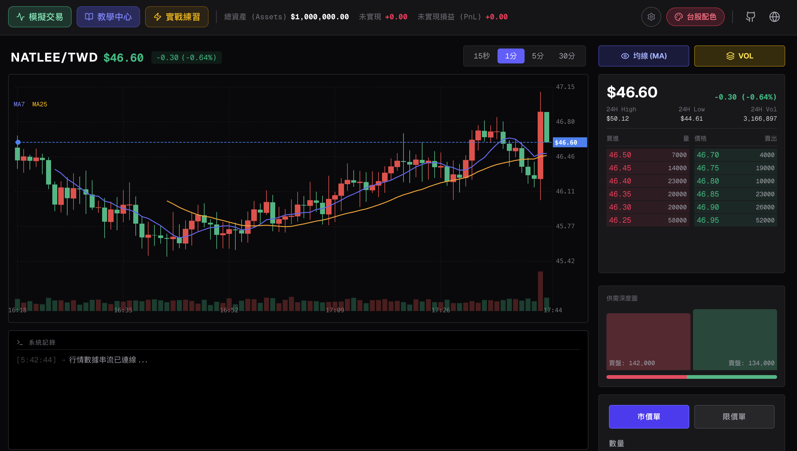
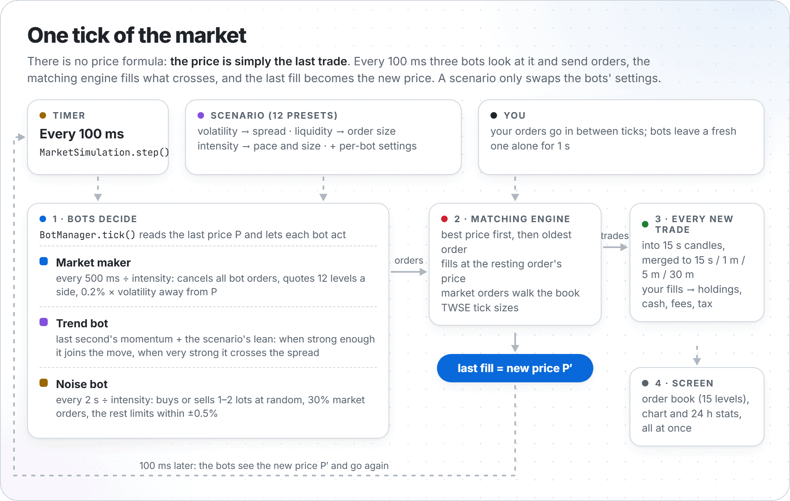
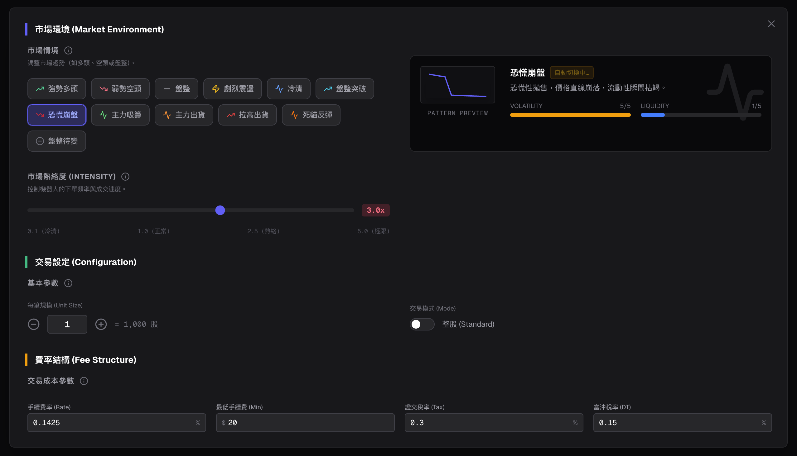
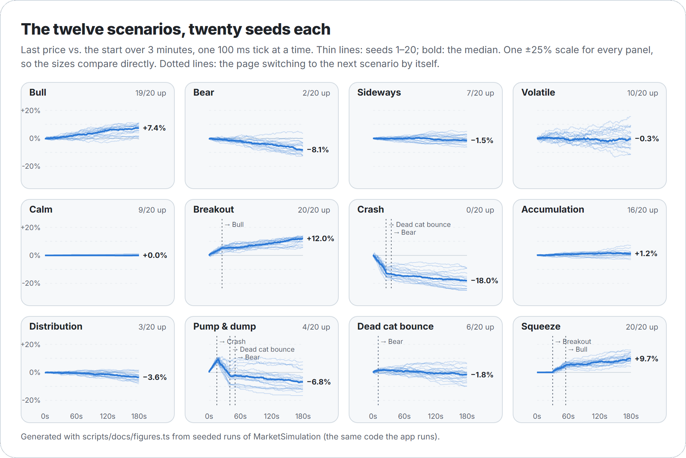
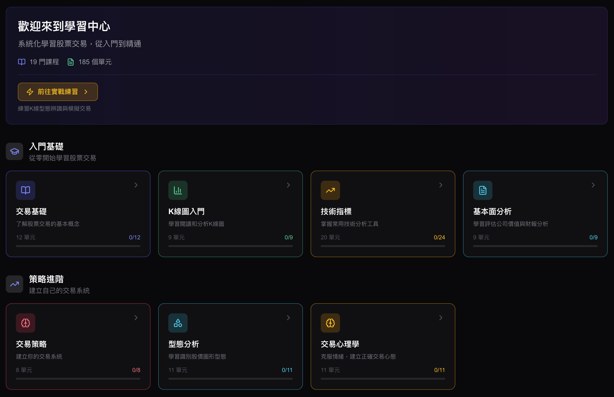
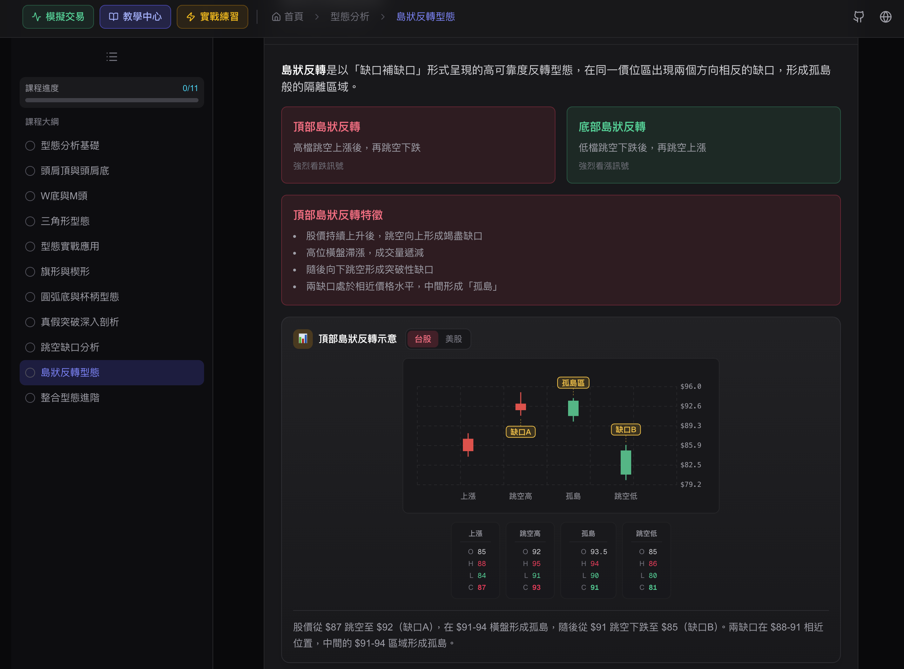
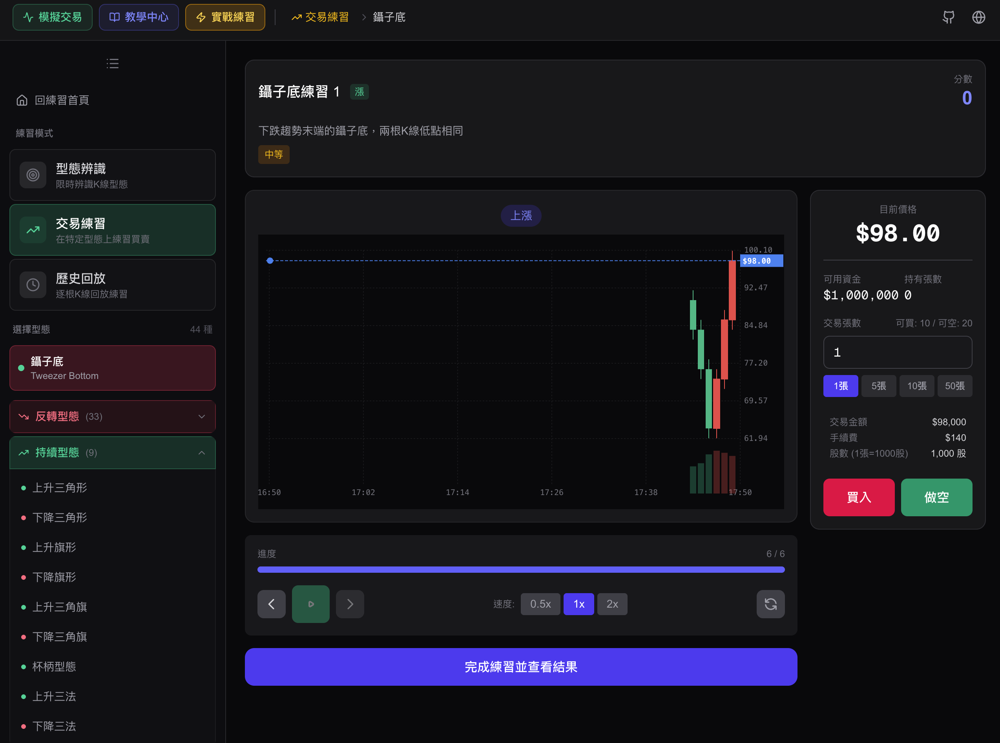
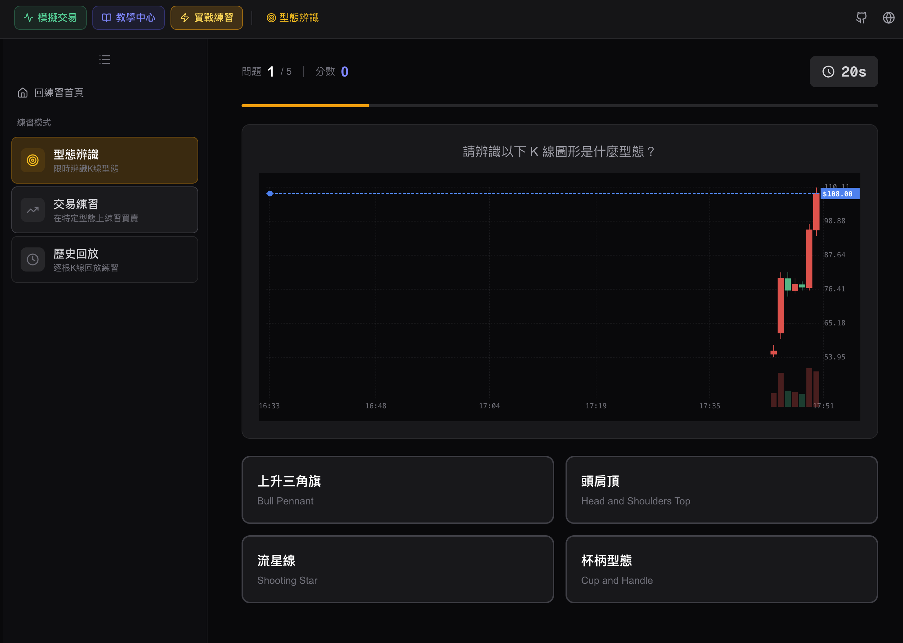

[繁體中文](README_zh-tw.md)

# Stonk! Stock Trading Simulator

<p>
  <a href="https://github.com/NatLee/stock-trading-simulation/actions/workflows/ci.yml"></a>
  <a href="https://github.com/NatLee/stock-trading-simulation/actions/workflows/deploy.yml"></a>
  <a href="https://natlee.github.io/stock-trading-simulation/"></a>
</p>


*Main trading interface with real-time order book, candlestick chart, and trading panel*

A stock trading simulator that runs entirely in your browser. A real order-matching engine sits in the
middle, and three bots (a market maker, a trend follower and a noisy crowd) trade against each other
and against you every 100 ms, so the price, the order book and the candles all come out of actual
trades. Twelve market scenarios retune the bots, from a calm, empty market to a pump and dump. Around
it there is a learning center with 19 courses and a practice center for chart patterns.

**Try it:** <https://natlee.github.io/stock-trading-simulation/>

## How the market works

<picture>
  <source media="(prefers-color-scheme: dark)" srcset="docs/images/tick-loop-dark.png">
  
</picture>

There is no price formula: the price is the last trade. The market maker quotes a ladder around it,
the noise bot and the trend bot take those quotes, and every fill moves the price one step.
Scenarios only change the bots' settings (spread, activity, how eagerly the trend bot joins a move).

**[How the bots move the price](docs/bots.md)** explains every bot with its formulas, what each of the
twelve scenarios changes, charts of each scenario from seeded runs, and a few places where the app does
not do what the scenario presets say.

## Features

### Trading simulation

- **Matching engine**: price-time priority, fills at the resting order's price, partial fills
- **Order types**: market and limit orders
- **Order conditions**: GTC (Good Till Cancel), IOC (Immediate Or Cancel), FOK (Fill Or Kill)
- **Order book**: live bid/ask depth, with bot orders shown or hidden
- **Candlestick charts**: 15 s, 1 m, 5 m and 30 m, with moving averages and volume
- **24 h statistics**: high, low, volume and change
- **Holdings**: lot-by-lot positions (long and short) with P&L, commission and Taiwan's transaction tax
  (day-trade rate included)
- **Trade history**: every fill of your orders


*Market scenario configuration and bot settings*

### Bot-driven market

- **Market maker**: re-quotes a ladder of 12 levels on each side around the last price
- **Trend bot**: follows the last second's momentum, nudged by the scenario
- **Noise bot**: random 1–2 lot orders, market or limit, like a crowd of small traders

**Twelve scenarios**: 強勢多頭 Bull, 弱勢空頭 Bear, 盤整 Sideways, 劇烈震盪 Volatile, 冷清 Calm,
盤整突破 Breakout, 恐慌崩盤 Crash, 主力吸籌 Accumulation, 主力出貨 Distribution, 拉高出貨 Pump & dump,
死貓反彈 Dead cat bounce and 盤整待變 Squeeze. Four of them hand over to the next one by themselves
(pump & dump → crash → dead cat bounce, squeeze → breakout → bull).

<picture>
  <source media="(prefers-color-scheme: dark)" srcset="docs/images/scenarios-dark.png">
  
</picture>

### Learning center

19 courses across 4 categories:

| Category | Courses |
|----------|---------|
| **Beginner** | Trading Basics, Candlestick Charts, Technical Indicators, Fundamental Analysis |
| **Intermediate** | Trading Strategies, Risk Management, Chart Patterns, Trading Psychology |
| **Advanced** | Day Trading, Market Microstructure, Trading Scenarios, Stock Picking, Options, Sector Analysis |
| **Investment** | ETF Investing, Dividend Investing, Portfolio Management, US Stocks, Taiwan vs US Markets |

Interactive quizzes, visual charts and progress tracking.


*Interactive learning center with 19 courses across 4 categories*


*Detailed course content with visual charts and interactive quizzes*

### Practice center

- **Pattern recognition**: a quiz on chart patterns (head & shoulders, wedges, triangles, …)
- **Trading practice**: trade a specific pattern or a random one, risk-free
- **Rewind & replay**: step through the candles again and review your decisions

The practice charts are hand-made candle sequences (`src/data/practice/scenarios/*.json`), not the bot
market.


*Pattern recognition practice with candlestick charts*


*Interactive quiz mode for identifying chart patterns*

### Market analysis

A rule-based "AI" panel reads the live market: trend direction and strength, order book pressure,
RSI-style momentum and candle patterns, each with a confidence score.

### Also

- Taiwan Stock Exchange tick sizes
- Color theme toggle: Asian (red = up) or Western (green = up)
- Whole-lot and odd-lot modes
- Configurable commission, minimum fee and tax rates
- Market intensity slider

## Getting started

You need [Node.js](https://nodejs.org/) 22 or newer.

```bash
git clone https://github.com/NatLee/stock-trading-simulation.git
cd stock-trading-simulation
npm install
npm run dev
```

Open <http://localhost:3000>. To use another port: `npm run dev -- -p 8080`.

### Scripts

```bash
npm run dev          # development server
npm run build        # static site in out/ (what GitHub Pages serves)
npx serve out        # preview the built site (npm start does not work with a static export)
npm test             # unit tests (Vitest)
npm run lint         # ESLint
npm run typecheck    # TypeScript
npm run sim -- --scenario crash --seed 7   # run a scenario headless, see docs/bots.md
```

`npm run sim` prints a price sparkline and a summary for one seeded run:

```text
pump_dump (app, seed 2, 180 s)  0s pump_dump -> 15s crash -> 35s dead_cat
  50.00 ▁▁▂▃▃▂▄▄▅▆▆▅▅▆▆▆▆▅▆▆▆▆▆▇▆▆▆▅▆▆▆▆▆▆▆▆▆▅▅▆▆▇▇▇▇█▇▇▇▇▆▆▆▇▆▆▅▅▅▅▅ 55.90
  change +11.80%  high +20.20%  low +0.00%  1 s move 0.81%  spread 1.13%  74 trades/min
```

## Project structure

```
src/
├── app/                      # Next.js pages: trading (/), learn, practice
├── components/
│   ├── trading/              # Trading page: order form, order book, holdings, records
│   ├── chart/                # Canvas candlestick chart
│   ├── learn/, practice/, ai/, ui/
├── hooks/
│   ├── useMarketSimulator.ts # Runs MarketSimulation on a 100 ms timer for React
│   └── usePracticeEngine.ts  # Practice center
├── lib/
│   ├── sim/                  # MarketSimulation (one tick), seeded random + clock
│   ├── matching/             # MatchingEngine, OrderBook, CandleAggregator, tick sizes
│   ├── bots/                 # BotManager, MarketMakerBot, TrendBot, NoiseBot, scenario presets
│   ├── portfolio.ts          # What a fill does to lots, cash, fees and tax
│   └── aiAnalysis.ts         # Rule-based market analysis
├── data/                     # Course and practice content (JSON)
scripts/
├── simulate.ts               # npm run sim
└── docs/                     # Builds the figures in docs/images from seeded runs
docs/
├── bots.md                   # How the bots move the price
└── images/                   # Figures (src/ holds their HTML sources)
```

## Tech stack

[Next.js](https://nextjs.org/) 16 (App Router, static export), [React](https://react.dev/) 19,
TypeScript, [Tailwind CSS](https://tailwindcss.com/) 4, [Lucide](https://lucide.dev/) icons and
[Vitest](https://vitest.dev/) for tests. CI runs lint, type-check, tests and the build on Node 22 and 24;
every push to `main` deploys to GitHub Pages.

## Contributors

- [NatLee](https://github.com/NatLee)
