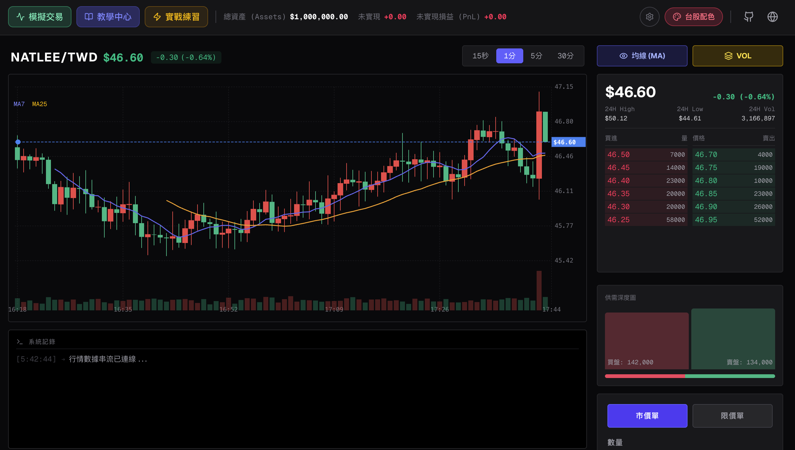
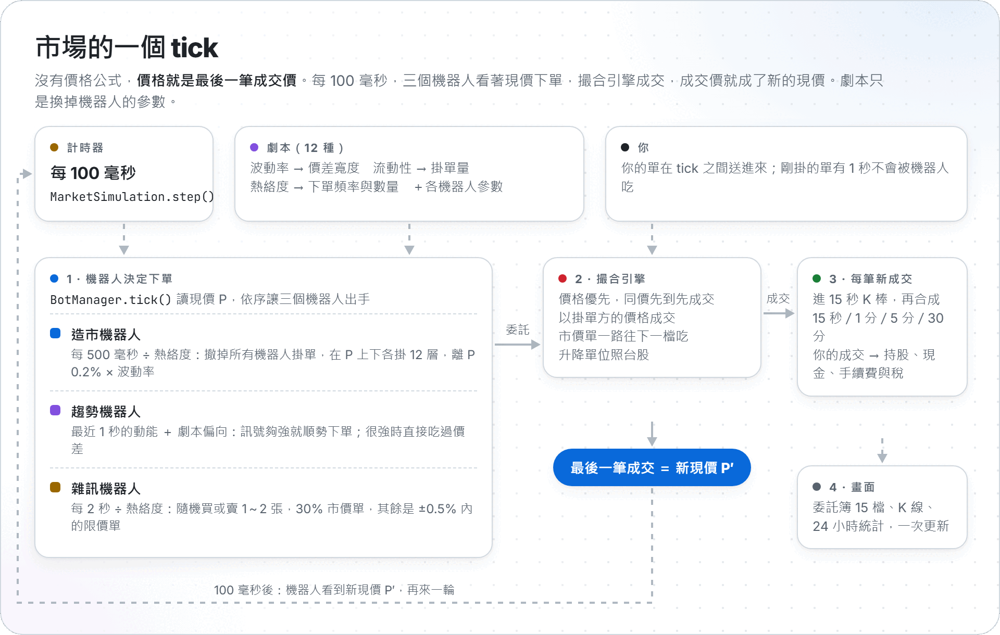
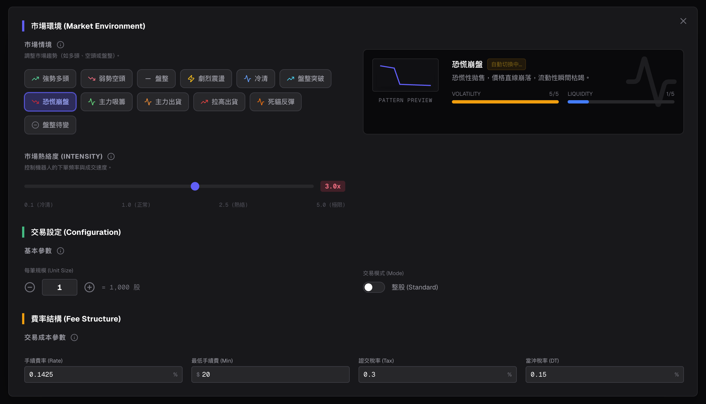
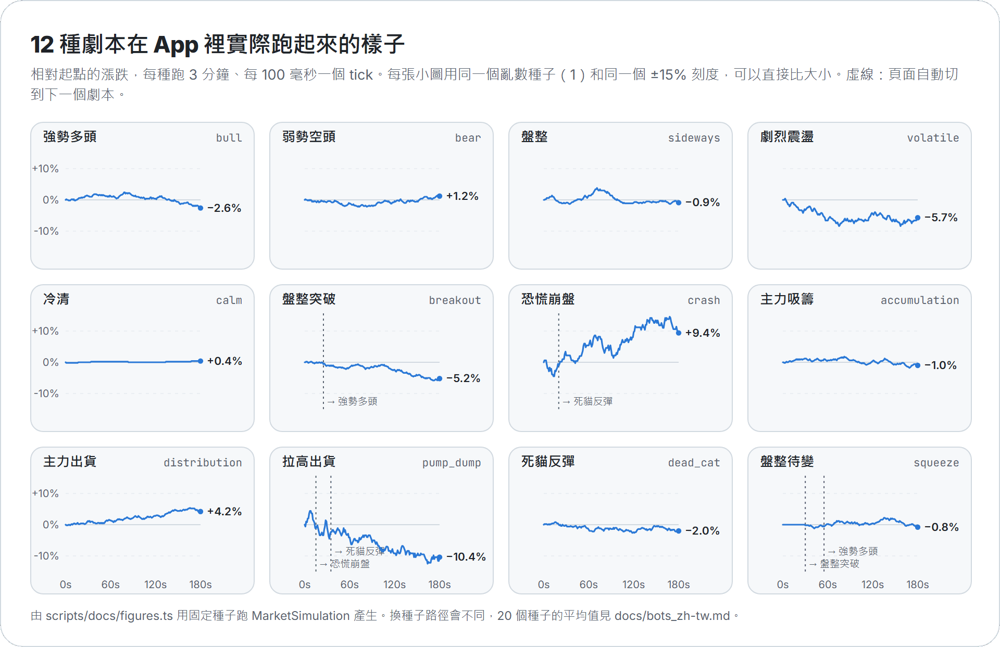
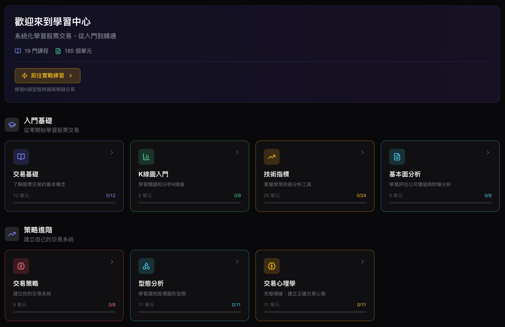
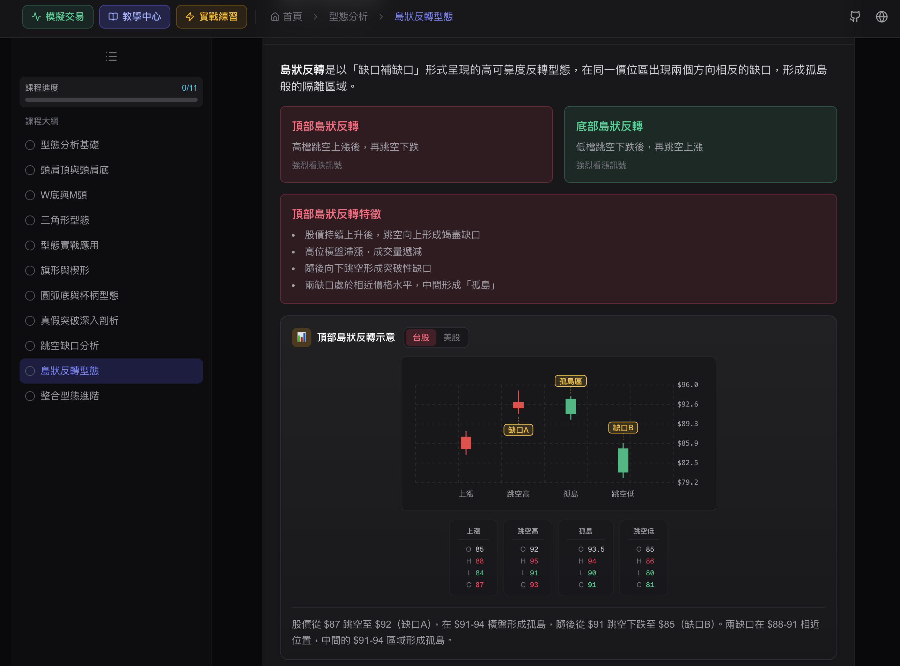
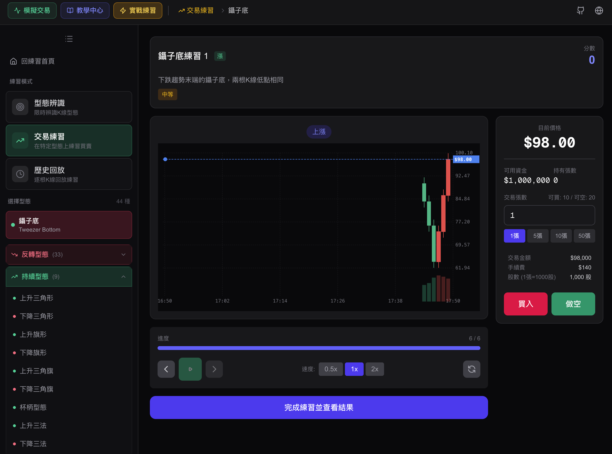
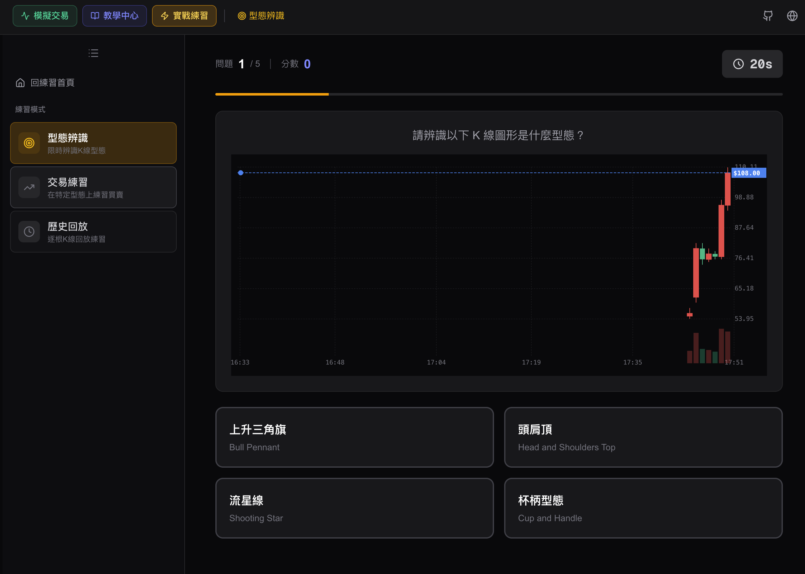

[English](README.md)

# Stonk! 股票交易模擬器

<p>
  <a href="https://github.com/NatLee/stock-trading-simulation/actions/workflows/ci.yml"></a>
  <a href="https://github.com/NatLee/stock-trading-simulation/actions/workflows/deploy.yml"></a>
  <a href="https://natlee.github.io/stock-trading-simulation/"></a>
</p>


*主交易介面，包含即時委託簿、K 線圖表與交易面板*

一個完全在瀏覽器裡執行的股票交易模擬器。中間是一個真的撮合引擎，三個機器人（造市、追趨勢、代表散戶的雜訊）每 100 毫秒互相交易，也跟你交易，所以價格、委託簿和 K 線都是真實成交出來的。12 種市場劇本會調整機器人的參數，從冷清沒人的市場到拉高出貨都有。另外還有 19 堂課的學習中心，以及練習 K 線型態的實戰練習。

**線上試玩：** <https://natlee.github.io/stock-trading-simulation/>

## 市場怎麼運作

<picture>
  <source media="(prefers-color-scheme: dark)" srcset="docs/images/tick-loop-zh-dark.png">
  
</picture>

沒有價格公式，價格就是最後一筆成交價。造市機器人圍著現價掛出一排報價，雜訊機器人和趨勢機器人來吃這些報價，每成交一次價格就走一步。劇本只是換掉機器人的參數（價差、活躍程度、趨勢機器人多快跟進）。

**[機器人怎麼讓價格動起來](docs/bots_zh-tw.md)** 用公式說明每個機器人、12 種劇本各改了什麼、用固定亂數種子跑出來的各劇本走勢圖，以及幾個 App 實際行為跟劇本設定不一樣的地方。

## 功能特色

### 交易模擬

- **撮合引擎**：價格優先、時間優先，以掛單方價格成交，支援部分成交
- **訂單類型**：市價單、限價單
- **訂單條件**：GTC（委託至取消）、IOC（立即成交否則取消）、FOK（全部成交否則取消）
- **委託簿**：即時買賣檔位，可以顯示或隱藏機器人掛單
- **K 線圖表**：15 秒、1 分、5 分、30 分，含均線與成交量
- **24 小時統計**：最高、最低、成交量、漲跌幅
- **持倉管理**：逐筆追蹤多空部位與損益，計入手續費和證交稅（含當沖減半）
- **交易紀錄**：你每一筆成交的紀錄


*市場情境與機器人設定*

### 機器人驅動的市場

- **造市機器人**：圍著現價，在買賣兩邊各掛 12 層報價並定時重掛
- **趨勢機器人**：追最近 1 秒的動能，再加上劇本給的偏向
- **雜訊機器人**：隨機下 1～2 張的市價或限價單，像一群小散戶

**12 種劇本**：強勢多頭、弱勢空頭、盤整、劇烈震盪、冷清、盤整突破、恐慌崩盤、主力吸籌、主力出貨、拉高出貨、死貓反彈、盤整待變。其中 4 種會自己接到下一個劇本（拉高出貨 → 恐慌崩盤 → 死貓反彈，盤整待變 → 盤整突破 → 強勢多頭）。

<picture>
  <source media="(prefers-color-scheme: dark)" srcset="docs/images/scenarios-zh-dark.png">
  
</picture>

### 學習中心

4 個類別，共 19 堂課：

| 類別 | 課程 |
|------|------|
| **入門** | 交易基礎、K 線圖、技術指標、基本面分析 |
| **進階** | 交易策略、風險管理、型態學、交易心理 |
| **高階** | 當沖、市場微結構、交易情境、選股、選擇權、產業分析 |
| **投資** | ETF 投資、存股、投資組合、美股、台美股比較 |

有互動測驗、圖解和學習進度。


*19 堂課、4 個類別的學習中心*


*課程內容，附圖表與互動測驗*

### 實戰練習

- **型態辨識**：K 線型態問答（頭肩頂、楔形、三角形……）
- **交易練習**：針對特定型態或隨機型態交易，不用擔心賠錢
- **回放復盤**：一根一根重看 K 線，檢討自己的決策

練習用的 K 線是手寫的資料（`src/data/practice/scenarios/*.json`），不是機器人市場。


*K 線型態辨識練習*


*辨識 K 線型態的問答模式*

### 市場分析

一個規則式的「AI」面板會讀取即時市場：趨勢方向與強度、委託簿買賣壓、類 RSI 的動能指標，以及 K 線型態，每項都附信心分數。

### 其他

- 台股升降單位
- 配色切換：台股（紅漲綠跌）或美股（綠漲紅跌）
- 整股與零股模式
- 可調整手續費率、最低手續費和稅率
- 市場熱絡度滑桿

## 開始使用

需要 [Node.js](https://nodejs.org/) 22 以上。

```bash
git clone https://github.com/NatLee/stock-trading-simulation.git
cd stock-trading-simulation
npm install
npm run dev
```

打開 <http://localhost:3000>。要換連接埠：`npm run dev -- -p 8080`。

### 指令

```bash
npm run dev          # 開發伺服器
npm run build        # 產生靜態網站到 out/（GitHub Pages 用的就是這個）
npx serve out        # 預覽 build 出來的網站（靜態匯出不能用 npm start）
npm test             # 單元測試（Vitest）
npm run lint         # ESLint
npm run typecheck    # TypeScript 型別檢查
npm run sim -- --scenario crash --seed 7   # 不開瀏覽器跑一個劇本，見 docs/bots_zh-tw.md
```

`npm run sim` 會印出一次固定種子執行的價格走勢和摘要：

```text
pump_dump (app, seed 2, 180 s)  0s pump_dump -> 15s crash -> 35s dead_cat
  50.00 ▁▁▂▃▃▂▄▄▅▆▆▅▅▆▆▆▆▅▆▆▆▆▆▇▆▆▆▅▆▆▆▆▆▆▆▆▆▅▅▆▆▇▇▇▇█▇▇▇▇▆▆▆▇▆▆▅▅▅▅▅ 55.90
  change +11.80%  high +20.20%  low +0.00%  1 s move 0.81%  spread 1.13%  74 trades/min
```

## 專案結構

```
src/
├── app/                      # Next.js 頁面：交易（/）、學習、練習
├── components/
│   ├── trading/              # 交易頁：下單、委託簿、持股、紀錄
│   ├── chart/                # Canvas K 線圖
│   ├── learn/, practice/, ai/, ui/
├── hooks/
│   ├── useMarketSimulator.ts # 每 100 毫秒為 React 執行一次 MarketSimulation
│   └── usePracticeEngine.ts  # 實戰練習
├── lib/
│   ├── sim/                  # MarketSimulation（一個 tick）、固定種子亂數與時鐘
│   ├── matching/             # 撮合引擎、委託簿、K 棒彙整、升降單位
│   ├── bots/                 # BotManager、三個機器人、劇本設定
│   ├── portfolio.ts          # 一筆成交對持股、現金、手續費、稅的影響
│   └── aiAnalysis.ts         # 規則式市場分析
├── data/                     # 課程與練習資料（JSON）
scripts/
├── simulate.ts               # npm run sim
└── docs/                     # 用固定種子跑引擎，產生 docs/images 裡的圖
docs/
├── bots_zh-tw.md             # 機器人怎麼讓價格動起來
└── images/                   # 圖片（src/ 是它們的 HTML 原始檔）
```

## 技術

[Next.js](https://nextjs.org/) 16（App Router、靜態匯出）、[React](https://react.dev/) 19、TypeScript、[Tailwind CSS](https://tailwindcss.com/) 4、[Lucide](https://lucide.dev/) 圖示，測試用 [Vitest](https://vitest.dev/)。CI 在 Node 22 和 24 上跑 lint、型別檢查、測試和 build；每次推到 `main` 都會部署到 GitHub Pages。

## 貢獻者

- [NatLee](https://github.com/NatLee)
