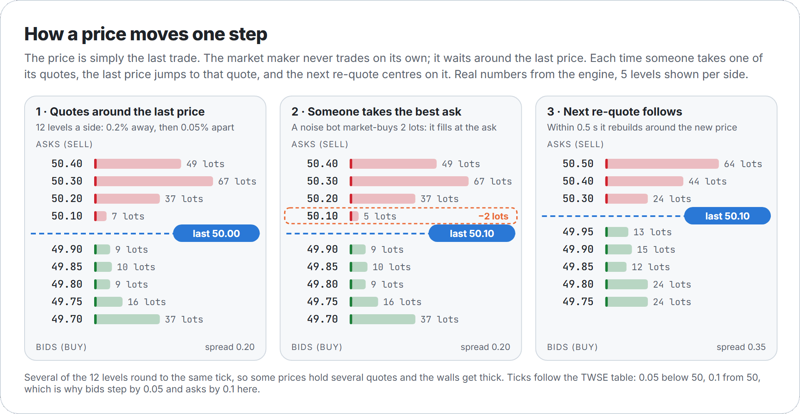

[繁體中文](bots_zh-tw.md)

# How the bots move the price

There is no price formula in Stonk!. The price on the screen is simply **the last trade**. Three bots
send orders every 100 ms, a matching engine fills whatever crosses, and the last fill becomes the new
price. A scenario (劇本) does not script the chart either: it only changes the bots' settings.

This page explains, with the real numbers from the code:

- [One tick](#one-tick): what happens every 100 ms
- [The matching engine](#the-matching-engine): how orders meet
- [The three bots](#the-three-bots): what each one does, with its formulas
- [Why the price moves at all](#why-the-price-moves-at-all)
- [The twelve scenarios](#the-twelve-scenarios): what each preset changes, and what it does over 20 runs
- [The market maker's inventory](#the-market-makers-inventory): why it quotes lower when it holds too much
- [Known quirks](#known-quirks)
- [Run it yourself](#run-it-yourself)

Every number in the pictures and tables comes from the bot config and from seeded runs of the same
engine the app uses (`scripts/docs/figures.ts`), so they can be regenerated exactly.

## One tick

<picture>
  <source media="(prefers-color-scheme: dark)" srcset="images/tick-loop-dark.png">
  
</picture>

Every 100 ms the page calls `MarketSimulation.step()` (`src/lib/sim/MarketSimulation.ts`):

1. **Bots decide.** `BotManager.tick()` reads the last price P once, then:
   - every 5 s cancels bot orders more than 10% away from P,
   - notes whether the best bid or ask is a user order placed less than 1 s ago (bots will not trade
     against it yet, see [user orders](#user-orders)),
   - feeds P to the trend bot's memory,
   - books every fill of the market maker's quotes since the last tick into its inventory,
   - lets the market maker re-quote if it is due, then the trend bot and the noise bot act.
2. **Matching.** Every bot order goes straight into `MatchingEngine.submitOrder()` and is filled
   against the book on the spot. The last fill sets the new price.
3. **Trades.** `step()` collects every trade since the previous tick (bots' and yours) through a trade
   cursor, puts them into 15 s candles, and the page books your own fills into holdings and cash.
4. **Screen.** One snapshot of the order book (15 levels), candles and 24 h stats goes to React.

Before the first tick the chart is filled with a synthetic history: a random walk of 15 s candles from
the market open (09:00) to now (each candle moves by `trend + (U − 0.5) × vol`, with `vol = 0.2–0.5%`
and a tiny random `trend`; `U` is a uniform random number in [0, 1)). The engine starts at the last
close of that history.

## The matching engine

`src/lib/matching/MatchingEngine.ts` is a small, honest limit order book:

- **Price-time priority.** The best price fills first; at the same price, the oldest order first.
- **Trades happen at the resting (maker) order's price.** A buy limit at 50.30 that meets an ask at
  50.10 trades at 50.10.
- **Market orders walk the book** level by level until they are filled. Under GTC the unfilled rest
  becomes a limit order at the last fill price; under IOC it is dropped; FOK fills completely or not at
  all. (The order form sends market orders as IOC by default.)
- **Prices snap to the Taiwan Stock Exchange tick table:** 0.01 below 10, 0.05 below 50, 0.1 below 100,
  0.5 below 500, 1 below 1000, 5 above. Nothing goes below 0.01.

## The three bots

Notation: P is the last price, U a fresh uniform random number in [0, 1), I the intensity (the
"市場熱絡度" slider, set by the scenario). Bots think in lots; `BotManager` turns lots into shares at the
end (see [order sizes](#order-sizes)). Every named number below is a field of the bot config tables in
`src/lib/bots/types.ts` (`DEFAULT_*_CONFIG`, overridden per scenario), shown with its default.

### Market maker (`MarketMakerBot`)

The market maker is the order book. It never trades on its own initiative; it only waits.

Every `refreshInterval / I` (500 ms at I = 1) it **cancels every resting bot order** (its own and the
other bots') and posts a fresh ladder of `L = depth + floor(depthPerIntensity × I)` levels on each side
(10 + 2 = 12 levels at I = 1):

```
s      = spreadPercent × volatility                    (spreadPercent 0.2%)
q      = clamp(inventory / inventoryLimit, −1, 1)       (inventory in lots: + long, − short; limit 50)
shift  = q × inventorySkew × s                         (inventorySkew 1: a full inventory moves one spread)
bid_i  = floorToTick( P × (1 − s − levelStepPercent × i − shift) )      i = 0 … L−1, levelStepPercent 0.05%
ask_i  = ceilToTick(  P × (1 + s + levelStepPercent × i − shift) )
size_i = floor( (2 + U × 8) × liquidity × (1 + depthSizeGrowth × i / L) )   lots, depthSizeGrowth 2
```

So the closest quotes sit `s` away from the last price, each further level 0.05% further out, and
deeper levels are up to three times bigger. At P = 50 several of the 12 levels round to the same tick,
so some prices carry several quotes: walls of 30–70 lots are normal.

The `shift` term is the inventory adjustment. When the market maker holds too much stock the whole
ladder moves down, so it sells more eagerly and buys less; when it is short the ladder moves up, so it
buys back. `BotManager` tells it which of its quotes were filled, see
[the market maker's inventory](#the-market-makers-inventory).

### Trend bot (`TrendBot`)

The trend bot follows momentum, with a lean set by the scenario.

Every tick it remembers P. When it is its turn it computes:

```
T = clamp( momentumScale × (avg of last 5 prices − avg of the 5 before) / avg of the 5 before, −1, 1 )
B = bias + U(±biasJitter)          the scenario's lean (see the table below), plus a random part
C = T + B                          (above 0 means buy)
strength = buyStrength if C > 0 else sellStrength      (both fall back to aggressiveness)
```

The 5 prices are `momentumWindow` ticks, so T compares the last 0.5 s with the 0.5 s before;
`momentumScale` is 100, so a 1% move in half a second already maxes it out. Then:

- **Too weak:** if `|C| < entryThreshold × (1 − strength)` (entryThreshold 0.3) it does nothing and
  checks again next tick.
- **Size:** `floor(2 + 3 × |C| × strength)` lots, so 2 to 5 lots.
- **Strong signal (|C| > aggressiveAbove, 0.6):** a limit order `crossPercent` (0.5%) past the price.
  That crosses the spread and walks the book like a market order with a price cap. It is sent 90% of
  the time (`aggressiveSendProbability`).
- **Normal signal:** a passive limit 0.1–0.3% (`passiveOffset`) on its own side of the price. It is
  sent 70% of the time (`passiveSendProbability`), and the market maker's next re-quote cancels it
  within half a second if nobody hit it.

After a turn (sent or skipped by the dice) it waits `tradeInterval / I` (default 3 s).

A **bias above 0.6** makes the bot cross the spread every turn in that direction, unless the momentum
is strongly against it: it becomes a steady buyer or seller, and `tradeInterval` sets how fast the
price walks. That is how crash, breakout, pump & dump and the slow accumulation get their direction.

### Noise bot (`NoiseBot`)

The noise bot is the crowd. Every `tradeInterval / I` (default 2 s) it sends one order:

```
side  = buy or sell, 50/50
size  = floor(1 + U × 2) lots          (1 or 2; the configured maximum of 3 never comes up)
type  = market with probability marketOrderProbability (default 30%), else limit
limit = roundToTick( P × (1 + (U − 0.5) × 2 × limitBand) )      (limitBand 0.5%: within ±0.5% of P)
```

Market orders hit the best bid or ask. Limit orders that land across the spread fill at once; the rest
rest until the next re-quote clears them.

### Order sizes

`BotManager.processOrders()` turns bot lots into shares:

```
whole lots:  shares = max(1000, round(lots × unitSize × √I / 1000) × 1000)     unitSize = 1000 × "每筆規模"
odd lots:    shares = floor(lots × 100 × √I) + a random 0–98
```

Bursts: if a bot's interval divided by I is half a tick or less, `BotManager` runs it several times in
one tick. No preset and no slider position (it stops at 5.0) gets there.

### User orders

Your orders go into the same book between ticks and fill by the same rules. When your order is the
first one at the best bid or ask and is less than 1 s old (`reactionDelay`), the bots skip market orders
and limit orders that would trade against it, as if they needed a moment to react.

## Why the price moves at all

<picture>
  <source media="(prefers-color-scheme: dark)" srcset="images/ladder-dark.png">
  
</picture>

The market maker always sits a spread away from the last price, so the price only changes when
someone **takes** one of its quotes:

1. A noise bot market-buys: it fills at the best ask, so the last price jumps up by about the spread.
2. Within half a second the market maker re-quotes around that new price.
3. The next taker moves it again, up or down.

That makes the price a random walk driven by the takers, with a step size of roughly
`spreadPercent × volatility` plus tick rounding. Each setting has a clear job:

- **Volatility** widens the spread, so every step is bigger.
- **Intensity** makes everyone act more often (more steps per minute) and a bit bigger (×√I).
- **The trend bot** adds direction and momentum: its bias tilts which side it trades, and above |C| = 0.6
  it crosses the spread itself.
- **The inventory shift** pushes the same way as a trend: after a rally the market maker is short and
  quotes higher to buy back, after a sell-off it is long and quotes lower. It also stops a run from
  going on forever: once its ask is further away than the trend bot's 0.5% price cap, the trend bot's
  buys stop filling until the inventory comes back.
- **Liquidity** only changes how many lots sit at each level. Bot orders are 1–5 lots against walls of
  dozens of lots, so it changes volume, not the path.
- **The tick size** puts a floor under the spread. Around 50 one tick is 0.1–0.2% of the price, so
  small spreads (calm, sideways, accumulation, distribution, squeeze) all round to the same one- or
  two-tick gap.

## The twelve scenarios


Each scenario is an entry in `SCENARIO_MODIFIERS` (`src/lib/bots/types.ts`) that lists only what differs
from the defaults. Picking a scenario always rebuilds the bots from the defaults plus that preset
(`resolveBotConfig`), so a scenario behaves the same whichever one came before. Picking one also moves the
intensity slider to the preset's intensity; moving the slider afterwards changes only the pace. Five
scenarios hand over to another one by themselves (`SCENARIO_LIFECYCLE`): pump & dump → crash after 15 s →
dead cat bounce after 25 s → bear after 10 s, and squeeze → breakout after 30 s → bull after 25 s.

What each preset sets (paces are the interval ÷ intensity, rounded up to the 100 ms tick, since a bot acts
on the first tick after its interval):

<!-- generated:scenario-presets -->
| Scenario | Volatility | Liquidity | Intensity | MM spread | MM levels/side | MM re-quote | Trend bias | Trend buy / sell strength | Trend every | Noise every | Noise market % | Then |
| --- | ---: | ---: | ---: | ---: | ---: | ---: | --- | --- | ---: | ---: | ---: | --- |
| 強勢多頭 Bull `bull` | 1.2 | 1.5 | 1.5 | 0.24% | 13 | 400 ms | +0.5 | 0.8 / 0.2 | 2000 ms | 1400 ms | 30% |  |
| 弱勢空頭 Bear `bear` | 1.2 | 1.2 | 1.5 | 0.24% | 13 | 400 ms | −0.5 | 0.2 / 0.8 | 2000 ms | 1400 ms | 30% |  |
| 盤整 Sideways `sideways` | 0.6 | 2 | 0.8 | 0.12% | 11 | 700 ms | 0 | 0.5 / 0.5 | 3800 ms | 1300 ms | 50% |  |
| 劇烈震盪 Volatile `volatile` | 1.8 | 0.8 | 2.5 | 0.54% | 15 | 200 ms | ±0.3 | 0.6 / 0.6 | 400 ms | 800 ms | 30% |  |
| 冷清 Calm `calm` | 0.3 | 3 | 0.3 | 0.06% | 10 | 1700 ms | – | off | – | 16700 ms | 30% |  |
| 盤整突破 Breakout `breakout` | 1.5 | 1.3 | 2 | 0.30% | 14 | 300 ms | +0.8 | 0.9 / 0.1 | 800 ms | 1000 ms | 50% | `bull` after 25 s |
| 恐慌崩盤 Crash `crash` | 1.5 | 0.5 | 3 | 0.30% | 11 | 200 ms | −0.8 | 0.05 / 0.95 | 500 ms | 400 ms | 70% | `dead_cat` after 25 s |
| 主力吸籌 Accumulation `accumulation` | 0.6 | 1.8 | 1.2 | 0.12% | 17 | 500 ms | +0.65 | 0.75 / 0.25 | 16700 ms | 1700 ms | 30% |  |
| 主力出貨 Distribution `distribution` | 0.8 | 1.5 | 1.3 | 0.16% | 14 | 400 ms | −0.65 | 0.25 / 0.75 | 15400 ms | 1600 ms | 30% |  |
| 拉高出貨 Pump & dump `pump_dump` | 1.5 | 1.2 | 4 | 0.30% | 18 | 200 ms | +0.8 | 0.9 / 0.1 | 200 ms | 500 ms | 30% | `crash` after 15 s |
| 死貓反彈 Dead cat bounce `dead_cat` | 1.5 | 0.8 | 2 | 0.30% | 14 | 300 ms | +0.8 | 0.6 / 0.4 | 1500 ms | 1000 ms | 30% | `bear` after 10 s |
| 盤整待變 Squeeze `squeeze` | 0.1 | 0.5 | 0.5 | 0.02% | 11 | 1000 ms | 0 | 0.1 / 0.1 | 10000 ms | 16000 ms | 30% | `breakout` after 30 s |
<!-- /generated:scenario-presets -->

How to read it:

- **Direction comes from the trend bias.** Bull and bear lean with ±0.5: the trend bot mostly places
  passive orders on its side and joins momentum. Breakout, crash, pump & dump, dead cat bounce,
  accumulation and distribution are above 0.6, so the trend bot crosses the spread every turn and its
  pace sets the speed: every 0.5 s in a crash, about every 17 s in accumulation.
- **Volatile** has no lean, only a random ±0.3 each turn, plus wide steps. Sideways, calm and squeeze have
  no lean at all.
- The presets were tuned on 2026-11-04 with seeded runs (`npm run sim -- --all --seeds 20`) to these
  targets: bull and bear end their way in at least 17 of 20 runs; crash falls 8–15% in its own phase in
  every run; pump & dump pumps and then ends below its start; dead cat bounces and then gives it back;
  volatile swings at least twice as wide as sideways but stays far from ±60%; calm stays within 1%.
  `scripts/lib/scenarioRun.test.ts` checks those targets on every CI run.

### What the scenarios do

<picture>
  <source media="(prefers-color-scheme: dark)" srcset="images/scenarios-dark.png">
  
</picture>

Twenty seeded runs per scenario, 3 minutes each, with the automatic switches. The real order book shows
the difference too. Here is the price and book card from the running app a few seconds after picking
calm and crash:


Averages over 20 seeds, 3 minutes each:

<!-- generated:scenario-stats -->
| Scenario | Avg change | Ended up | Own phase (before the switch) | Avg high–low range | Typical 1 s move | Avg spread | Trades/min |
| --- | ---: | ---: | --- | ---: | ---: | ---: | ---: |
| 強勢多頭 Bull `bull` | +6.4% | 19/20 |  | 7.7% | 0.20% | 0.63% | 23 |
| 弱勢空頭 Bear `bear` | −6.8% | 2/20 |  | 8.1% | 0.20% | 0.58% | 24 |
| 盤整 Sideways `sideways` | −0.9% | 7/20 |  | 3.9% | 0.14% | 0.37% | 33 |
| 劇烈震盪 Volatile `volatile` | −0.3% | 10/20 |  | 8.5% | 0.37% | 1.02% | 25 |
| 冷清 Calm `calm` | +0.1% | 9/20 |  | 0.4% | 0.03% | 0.29% | 2 |
| 盤整突破 Breakout `breakout` | +11.1% | 20/20 | +5.2% in 25 s, 20/20 up | 11.5% | 0.24% | 0.67% | 26 |
| 恐慌崩盤 Crash `crash` | −18.2% | 0/20 | −12.1% in 25 s, 0/20 up | 18.8% | 0.33% | 0.59% | 46 |
| 主力吸籌 Accumulation `accumulation` | +1.3% | 16/20 |  | 3.0% | 0.13% | 0.40% | 23 |
| 主力出貨 Distribution `distribution` | −3.4% | 3/20 |  | 4.4% | 0.14% | 0.41% | 23 |
| 拉高出貨 Pump & dump `pump_dump` | −6.2% | 4/20 | +8.4% in 15 s, 20/20 up | 16.6% | 0.39% | 0.55% | 53 |
| 死貓反彈 Dead cat bounce `dead_cat` | −2.1% | 6/20 | +1.3% in 10 s, 17/20 up | 6.5% | 0.21% | 0.65% | 26 |
| 盤整待變 Squeeze `squeeze` | +10.2% | 20/20 | +0.0% in 30 s, 14/20 up | 10.7% | 0.22% | 0.60% | 24 |
<!-- /generated:scenario-stats -->

"Own phase" is the change before the first automatic switch, for the scenarios that have one.
"Typical 1 s move" is the standard deviation of one-second price changes. Spreads are relative to the
mid price.

## The market maker's inventory

`BotManager` remembers the IDs of the market maker's resting quotes. At the start of every tick, before
the market maker re-quotes and cancels them, it reads every trade since the last tick from the engine's
trade cursor and books the quotes that were filled: a filled ask means the market maker sold, a filled
bid means it bought. The inventory is kept in lots (the page's lot size, or 100 shares in odd-lot mode).

The quotes then shift with it, as in the [formula above](#market-maker-marketmakerbot): too much
inventory moves the ladder down to sell, too little moves it up to buy back, by up to one spread at
50 lots. Without that adjustment nothing pulls the inventory back. With the same seeds, here is the
largest inventory the market maker reached in 10 runs of 3 minutes, with the adjustment on and with
`inventorySkew` set to 0:

<!-- generated:inventory -->
| Scenario | Peak inventory, skew on | Peak inventory, skew off |
| --- | ---: | ---: |
| 強勢多頭 Bull `bull` | 36 lots | 74 lots |
| 弱勢空頭 Bear `bear` | 48 lots | 89 lots |
| 盤整 Sideways `sideways` | 31 lots | 32 lots |
| 劇烈震盪 Volatile `volatile` | 28 lots | 50 lots |
| 冷清 Calm `calm` | 6 lots | 6 lots |
| 盤整突破 Breakout `breakout` | 47 lots | 246 lots |
| 恐慌崩盤 Crash `crash` | 106 lots | 387 lots |
| 主力吸籌 Accumulation `accumulation` | 51 lots | 55 lots |
| 主力出貨 Distribution `distribution` | 39 lots | 51 lots |
| 拉高出貨 Pump & dump `pump_dump` | 99 lots | 770 lots |
| 死貓反彈 Dead cat bounce `dead_cat` | 50 lots | 57 lots |
| 盤整待變 Squeeze `squeeze` | 51 lots | 230 lots |
<!-- /generated:inventory -->

`scripts/lib/scenarioRun.test.ts` checks this on every CI run, and `src/lib/bots/bots.test.ts` checks
the direction of the shift and the booking of fills.

## Known quirks

These are in the code today. They are small, or changing them would change how the game feels, so they
are written down rather than quietly changed.

1. **Re-quoting clears every bot order.** The market maker cancels all bot orders when it re-quotes,
   so passive trend and noise orders live at most `refreshInterval / I`.
2. **Sizes never reach their maximum.** Bot sizes are `floor(min + U × (max − min))`, so the noise bot
   never sends its maximum of 3 lots and the market maker's base size never reaches 10.
3. **Burst mode is out of reach.** It needs an interval of half a tick or less, which no preset or slider
   position gets to.

## Run it yourself

```bash
npm run sim -- --scenario crash --seed 7            # one run: sparkline and summary
npm run sim -- --all --seeds 20                      # averages over 20 seeds, how the presets are tuned
npm run sim -- --all --minutes 1                     # every scenario, seed 1
npm run sim -- --scenario pump_dump --no-lifecycle   # stay in pump & dump
```

<!-- generated:sim-example -->
```text
pump_dump (seed 2, 180 s)  0s pump_dump -> 15s crash -> 40s dead_cat -> 50s bear
  50.00 ▄▅▅▆▇██▇▆▆▅▅▄▄▄▄▄▄▄▄▄▄▄▄▄▄▄▅▅▄▄▄▄▄▄▄▄▃▃▃▃▂▂▂▂▂▂▂▂▂▂▂▂▂▁▁▁▁▁▁▁ 47.05
  change -5.90%  high +11.00%  low -6.00%  1 s move 0.37%  spread 0.56%  54 trades/min
```
<!-- /generated:sim-example -->

To rebuild the pictures and tables on this page: `npx tsx scripts/docs/figures.ts`, then
`node scripts/docs/render.mjs` (needs Edge or Chrome and ImageMagick).

In your own code, `MarketSimulation` takes a `SimEnv` with a seeded random source and a manual clock:

```ts
import { MarketSimulation, deterministicEnv } from '@/lib/sim';

const env = deterministicEnv(42);
const sim = new MarketSimulation({ initialPrice: 50, candlePeriod: 15000, bots: { scenario: 'volatile' } }, env);
for (let i = 0; i < 600; i++) {   // one minute
    env.clock.advance(100);
    sim.step();
}
console.log(sim.engine.getLastPrice());
```
