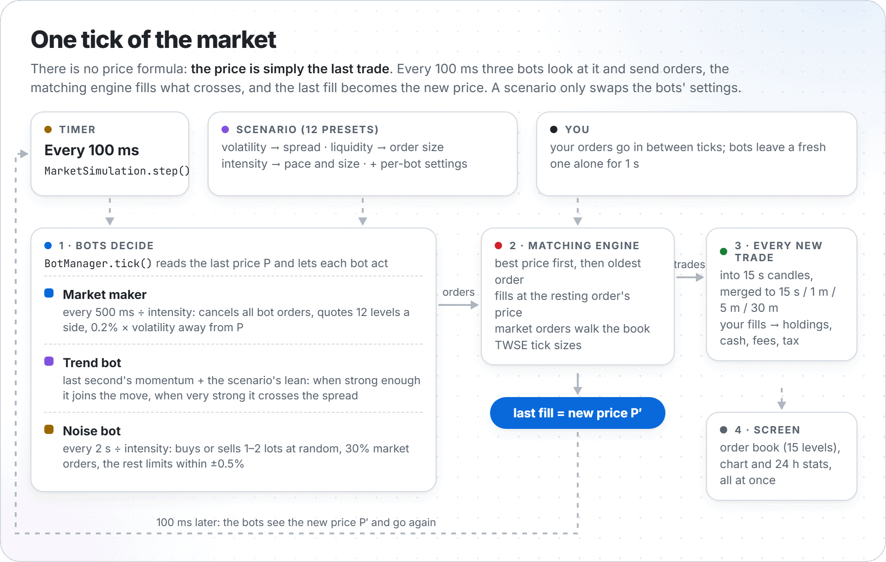
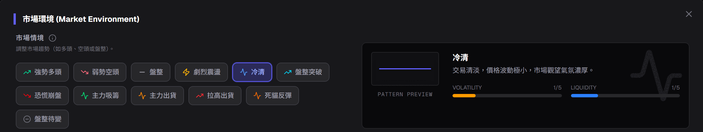
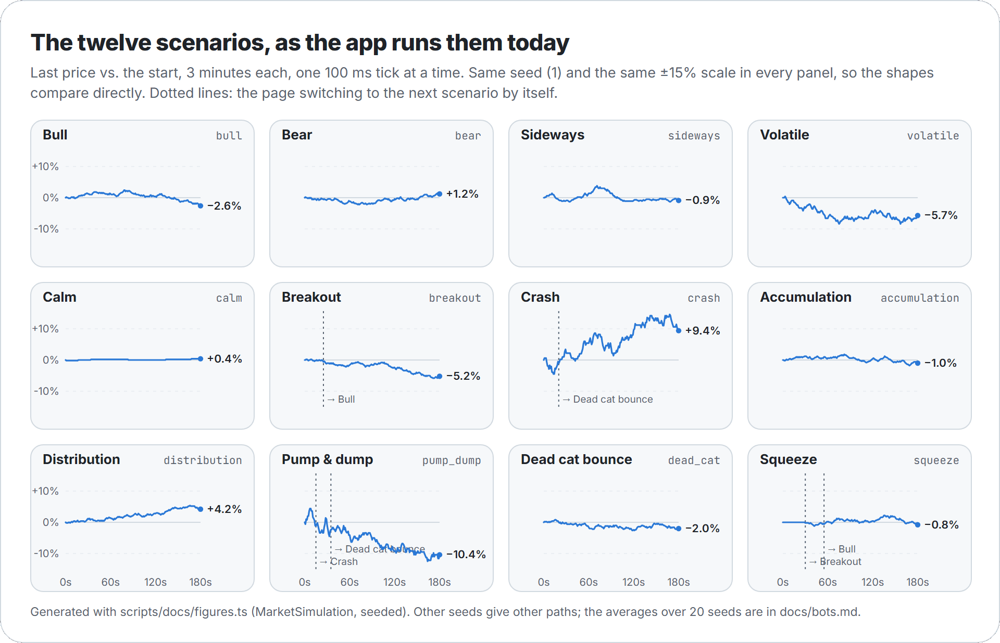
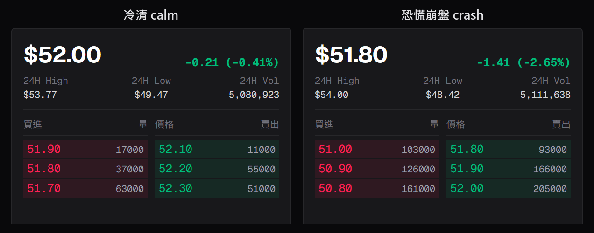
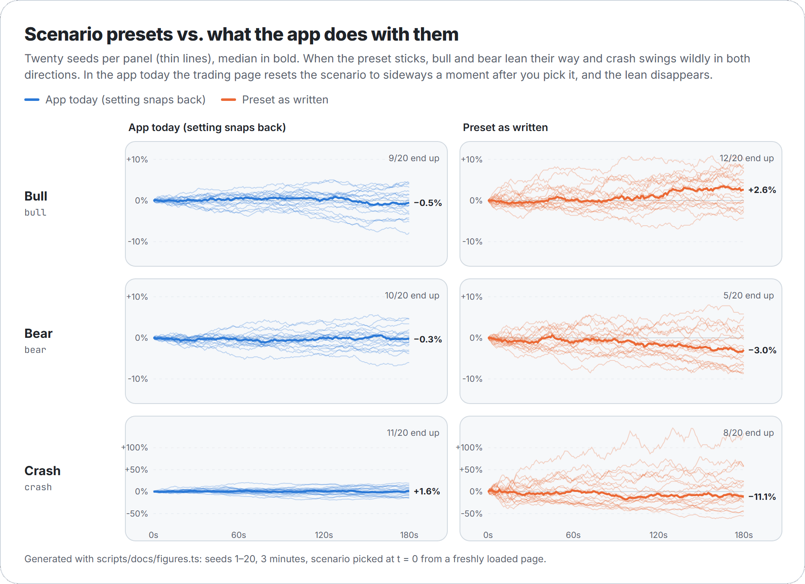

[繁體中文](bots_zh-tw.md)

# How the bots move the price

There is no price formula in Stonk!. The price on the screen is simply **the last trade**. Three bots
send orders every 100 ms, a matching engine fills whatever crosses, and the last fill becomes the new
price. A scenario (劇本) does not script the chart either: it only changes the bots' settings.

This page explains, with the real numbers from the code:

- [One tick](#one-tick): what happens every 100 ms
- [The matching engine](#the-matching-engine): how orders meet
- [The three bots](#the-three-bots): what each one does, with its formulas
- [Why the price moves at all](#why-the-price-moves-at-all)
- [The twelve scenarios](#the-twelve-scenarios): what each preset changes, and what it does in practice
- [Known quirks](#known-quirks): places where the app does not do what the presets say
- [Run it yourself](#run-it-yourself)

All charts on this page come from seeded runs of the same engine the app uses
(`scripts/docs/figures.ts`), so they can be regenerated exactly.

## One tick

<picture>
  <source media="(prefers-color-scheme: dark)" srcset="images/tick-loop-dark.png">
  
</picture>

Every 100 ms the page calls `MarketSimulation.step()` (`src/lib/sim/MarketSimulation.ts`):

1. **Bots decide.** `BotManager.tick()` reads the last price P once, then:
   - every 5 s cancels bot orders more than 10% away from P,
   - notes whether the best bid or ask is a user order placed less than 1 s ago (bots will not trade
     against it yet, see [user orders](#user-orders)),
   - feeds P to the trend bot's memory,
   - lets the market maker re-quote if it is due, then the trend bot and the noise bot act.
2. **Matching.** Every bot order goes straight into `MatchingEngine.submitOrder()` and is filled
   against the book on the spot. The last fill sets the new price.
3. **Trades.** `step()` collects every trade since the previous tick (bots' and yours) through a trade
   cursor, puts them into 15 s candles, and the page books your own fills into holdings and cash.
4. **Screen.** One snapshot of the order book (15 levels), candles and 24 h stats goes to React.

Before the first tick the chart is filled with a synthetic history: a random walk of 15 s candles from
09:00 to now (each candle moves by `trend + (U − 0.5) × vol`, with `vol = 0.2–0.5%` and a tiny random
`trend`; `U` is a uniform random number in [0, 1)). The engine starts at the last close of that history.

## The matching engine

`src/lib/matching/MatchingEngine.ts` is a small, honest limit order book:

- **Price-time priority.** The best price fills first; at the same price, the oldest order first.
- **Trades happen at the resting (maker) order's price.** A buy limit at 50.30 that meets an ask at
  50.10 trades at 50.10.
- **Market orders walk the book** level by level until they are filled. Under GTC the unfilled rest
  becomes a limit order at the last fill price; under IOC it is dropped; FOK fills completely or not at
  all. (The order form sends market orders as IOC by default.)
- **Prices snap to the Taiwan Stock Exchange tick table:** 0.01 below 10, 0.05 below 50, 0.1 below 100,
  0.5 below 500, 1 below 1000, 5 above. Nothing goes below 0.01.

## The three bots

Notation: P is the last price, U a fresh uniform random number in [0, 1), I the intensity (the
"市場熱絡度" slider, set by the scenario). Bots think in lots; `BotManager` turns lots into shares at the
end (see [order sizes](#order-sizes)).

### Market maker (`MarketMakerBot`)

The market maker is the order book. It never trades on its own initiative; it only waits.

Every `500 ms / I` it **cancels every resting bot order** (its own and the other bots') and posts a fresh
ladder of `L = depth + floor(2 × I)` levels on each side (default depth 10, so 12 levels at I = 1):

```
s      = spreadPercent × volatility             (default spreadPercent 0.2%)
bid_i  = floorToTick( P × (1 − s − 0.0005 × i) )      i = 0 … L−1
ask_i  = ceilToTick(  P × (1 + s + 0.0005 × i) )
size_i = floor( (2 + U × 8) × liquidity × (1 + 2i / L) )   lots
```

So the closest quotes sit `s` away from the last price, each further level 0.05% further out, and
deeper levels are up to three times bigger. At P = 50 several of the 12 levels round to the same tick,
so some prices carry several quotes: walls of 30–70 lots are normal.

`MarketMakerBot` also has an inventory skew (shift quotes when it holds too much), but nothing ever
reports fills to it, so its inventory stays 0 and the quotes are always symmetric
([quirk 4](#known-quirks)).

### Trend bot (`TrendBot`)

The trend bot follows momentum, with a nudge from the scenario.

Every tick it remembers P. When it is its turn it computes:

```
T = clamp( 100 × (avg of last 5 prices − avg of the 5 before) / avg of the 5 before, −1, 1 )
B = scenario bias: bull +0.3, bear −0.3, volatile a random ±0.2, all others 0
C = T + B                                   (above 0 means buy)
strength = buyStrength if C > 0 else sellStrength      (both fall back to aggressiveness)
```

The 5 prices are 5 ticks, so T compares the last 0.5 s with the 0.5 s before; a 1% move in half a
second already maxes it out. Then:

- **Too weak:** if `|C| < 0.3 × (1 − strength)` it does nothing and checks again next tick.
- **Size:** `floor(2 + 3 × |C| × strength)` lots, so 2 to 5 lots.
- **Strong signal (|C| > 0.6):** a limit order at `P × 1.005` (buy) or `P × 0.995` (sell). That crosses
  the spread and walks the book like a market order with a price cap. It is sent 90% of the time.
- **Normal signal:** a passive limit 0.1–0.3% on its own side of the price (a bid below P, an ask
  above). It is sent 70% of the time, and the market maker's next re-quote cancels it within half a
  second if nobody hit it.

After a turn (sent or skipped by the dice) it waits `tradeInterval / I` (default 3 s).

### Noise bot (`NoiseBot`)

The noise bot is the crowd. Every `tradeInterval / I` (default 2 s) it sends one order:

```
side  = buy or sell, 50/50
size  = floor(1 + U × 2) lots          (1 or 2; the configured maximum of 3 never comes up)
type  = market with probability marketOrderProbability (default 30%), else limit
limit = roundToTick( P × (1 + (U − 0.5) × 1%) )      (within ±0.5% of P)
```

Market orders hit the best bid or ask. Limit orders that land across the spread fill at once; the rest
rest until the next re-quote clears them.

### Order sizes

`BotManager.processOrders()` turns bot lots into shares:

```
whole lots:  shares = max(1000, round(lots × unitSize × √I / 1000) × 1000)     unitSize = 1000 × "每筆規模"
odd lots:    shares = floor(lots × 100 × √I) + a random 0–98
```

Bursts: if a bot's interval divided by I drops below the 100 ms tick, `BotManager` runs it several times
in one tick. With the slider capped at 5.0 that never happens (the fastest is 500 ms / 5 = 100 ms).

### User orders

Your orders go into the same book between ticks and fill by the same rules. When your order is the
first one at the best bid or ask and is less than 1 s old (`reactionDelay`), the bots skip market orders
and limit orders that would trade against it, as if they needed a moment to react.

## Why the price moves at all

<picture>
  <source media="(prefers-color-scheme: dark)" srcset="images/ladder-dark.png">
  
</picture>

The market maker always sits a spread away from the last price, so the price only changes when
someone **takes** one of its quotes:

1. A noise bot market-buys: it fills at the best ask, so the last price jumps up by about the spread.
2. Within half a second the market maker re-quotes around that new price.
3. The next taker moves it again, up or down.

That makes the price a random walk driven by the takers, with a step size of roughly
`spreadPercent × volatility` plus tick rounding. Each setting has a clear job:

- **Volatility** widens the spread, so every step is bigger.
- **Intensity** makes everyone act more often (more steps per minute) and a bit bigger (×√I).
- **The trend bot** adds momentum: after a run of up-steps it joins in, and above |C| = 0.6 it crosses
  the spread itself. The scenario bias and the buy/sell strengths tilt which side it joins.
- **Liquidity** only changes how many lots sit at each level. Bot orders are 1–5 lots against walls of
  dozens of lots, so it changes volume, not the path.
- **The tick size** puts a floor under the spread. Around 50 one tick is 0.1–0.2% of the price, so
  small spreads (calm, sideways, accumulation, distribution, squeeze) all round to the same one- or
  two-tick gap. That is why accumulation and distribution come out exactly the same in both columns of
  the 20-seed table below: the only things that differ there are liquidity and a spread that rounds to
  the same tick.

## The twelve scenarios



Each scenario is an entry in `SCENARIO_MODIFIERS` (`src/lib/bots/types.ts`). Picking one sets the
intensity slider to the preset's intensity too. Four scenarios switch to another one on their own
(`SCENARIO_LIFECYCLE`): pump & dump → crash after 15 s → dead cat bounce after 20 s, and squeeze →
breakout after 30 s → bull after 25 s.

What each preset sets, picked on a freshly loaded page (derived values are computed from the
formulas above):

| Scenario | Volatility | Liquidity | Intensity | MM spread | MM levels/side | MM re-quote | Trend buy / sell strength | Trend every | Noise every | Noise market % | Trend bias | Then |
|---|---:|---:|---:|---:|---:|---:|---|---:|---:|---:|---:|---|
| 強勢多頭 `bull` | 1.2 | 1.5 | 1.5 | 0.24% | 13 | 333 ms | 0.8 / 0.2 | 2000 ms | 667 ms | 50% | +0.3 |  |
| 弱勢空頭 `bear` | 1.3 | 1.2 | 1.5 | 0.26% | 13 | 333 ms | 0.2 / 0.8 | 2000 ms | 667 ms | 50% | −0.3 |  |
| 盤整 `sideways` | 0.6 | 2 | 0.8 | 0.12% | 11 | 625 ms | 0.5 / 0.5 | 3750 ms | 1250 ms | 50% | 0 |  |
| 劇烈震盪 `volatile` | 2.5 | 0.8 | 2.5 | 1.25% | 15 | 200 ms | 0.6 / 0.6 | 400 ms | 400 ms | 50% | ±0.2 random |  |
| 冷清 `calm` | 0.3 | 3 | 0.3 | 0.06% | 10 | 1667 ms | off | – | 16667 ms | 30% | 0 |  |
| 盤整突破 `breakout` | 1.8 | 1.3 | 2 | 0.36% | 14 | 250 ms | 0.9 / 0.1 | 750 ms | 1000 ms | 50% | 0 | `bull` after 25 s |
| 恐慌崩盤 `crash` | 3 | 0.5 | 3 | 3.00% | 11 | 167 ms | 0.05 / 0.95 | 267 ms | 333 ms | 70% | 0 | `dead_cat` after 20 s |
| 主力吸籌 `accumulation` | 0.6 | 1.8 | 1.2 | 0.12% | 17 | 417 ms | 0.75 / 0.25 | 1667 ms | 833 ms | 50% | 0 |  |
| 主力出貨 `distribution` | 0.8 | 1.5 | 1.3 | 0.16% | 14 | 385 ms | 0.3 / 0.7 | 1538 ms | 769 ms | 50% | 0 |  |
| 拉高出貨 `pump_dump` | 2.5 | 1.2 | 4 | 2.50% | 18 | 125 ms | 0.9 / 0.1 | 125 ms | 250 ms | 50% | 0 | `crash` after 15 s |
| 死貓反彈 `dead_cat` | 2 | 0.8 | 2 | 0.40% | 14 | 250 ms | 0.6 / 0.4 | 750 ms | 500 ms | 50% | 0 |  |
| 盤整待變 `squeeze` | 0.1 | 0.5 | 0.5 | 0.02% | 11 | 1000 ms | 0.5 / 0.5 | 10000 ms | 16000 ms | 30% | 0 | `breakout` after 30 s |

How to read it:

- Only bull, bear and volatile have a **bias**. Every other "directional" scenario (breakout, crash,
  accumulation, distribution, pump & dump, dead cat) leans only through asymmetric strengths: with
  strength 0.9 the trend bot buys on a +0.03 signal, with 0.1 it needs −0.27 to sell. That makes it
  quicker to join moves on one side, but it does not create moves by itself.
- The **noise** columns show sideways values for most scenarios, because those presets do not set the
  noise bot and keep what was there ([quirk 2](#known-quirks)).
- In the app today the market maker's spread is `spreadPercent × 0.6` for every scenario except
  sideways ([quirk 1](#known-quirks)): 0.12% for most, 0.30% for volatile, 0.60% for crash and
  pump & dump.

### What the scenarios do in the app today

<picture>
  <source media="(prefers-color-scheme: dark)" srcset="images/scenarios-dark.png">
  
</picture>

Same seed, same scale, 3 minutes each, as the trading page runs them right now. Calm barely moves, and
volatile, crash and pump & dump clearly swing harder. Bull and bear, though, do not lean their way: in
this run bull ends at −2.6%.

The real order book shows the same difference. Here is the price and book card from the running app a
few seconds after picking calm and crash:



Averages over 20 seeds, 3 minutes each (`app` = the app today, `preset` = the preset as written,
explained in the next section):

| Scenario | Mode | Avg change | Ended up | Avg high–low range | Typical 1 s move | Avg spread | Trades/min |
|---|---|---:|---:|---:|---:|---:|---:|
| Bull `bull` | app | −0.6% | 9/20 | 4.3% | 0.20% | 0.39% | 59 |
|  | preset | +2.7% | 12/20 | 7.6% | 0.34% | 0.65% | 56 |
| Bear `bear` | app | −0.3% | 10/20 | 3.8% | 0.20% | 0.39% | 59 |
|  | preset | −2.8% | 5/20 | 7.4% | 0.33% | 0.63% | 56 |
| Sideways `sideways` | app | +0.3% | 8/20 | 3.8% | 0.19% | 0.51% | 30 |
|  | preset | +0.5% | 8/20 | 3.0% | 0.14% | 0.39% | 32 |
| Volatile `volatile` | app | +0.1% | 10/20 | 7.5% | 0.43% | 0.63% | 92 |
|  | preset | +2.8% | 10/20 | 35.1% | 1.47% | 1.91% | 99 |
| Calm `calm` | app | +0.1% | 9/20 | 0.6% | 0.04% | 0.40% | 2 |
|  | preset | +0.1% | 9/20 | 0.4% | 0.03% | 0.29% | 2 |
| Breakout `breakout` | app | −0.7% | 7/20 | 4.0% | 0.19% | 0.39% | 57 |
|  | preset | +0.3% | 8/20 | 4.7% | 0.25% | 0.69% | 29 |
| Crash `crash` | app | +1.2% | 11/20 | 15.1% | 0.75% | 1.29% | 70 |
|  | preset | +4.2% | 8/20 | 59.6% | 2.74% | 3.80% | 103 |
| Accumulation `accumulation` | app | −0.5% | 9/20 | 3.4% | 0.18% | 0.38% | 46 |
|  | preset | −0.5% | 9/20 | 3.4% | 0.18% | 0.38% | 46 |
| Distribution `distribution` | app | −0.6% | 9/20 | 3.8% | 0.18% | 0.38% | 51 |
|  | preset | −0.6% | 9/20 | 3.8% | 0.18% | 0.38% | 51 |
| Pump & dump `pump_dump` | app | +3.1% | 10/20 | 19.5% | 0.75% | 1.11% | 73 |
|  | preset | −8.3% | 5/20 | 60.4% | 2.82% | 3.58% | 102 |
| Dead cat bounce `dead_cat` | app | −0.7% | 8/20 | 4.5% | 0.23% | 0.40% | 82 |
|  | preset | −1.4% | 9/20 | 10.5% | 0.50% | 0.93% | 69 |
| Squeeze `squeeze` | app | +0.1% | 7/20 | 3.8% | 0.18% | 0.39% | 47 |
|  | preset | +0.1% | 8/20 | 4.6% | 0.23% | 0.59% | 25 |

"Typical 1 s move" is the standard deviation of one-second price changes. Spreads are relative to the
mid price.

## Known quirks

These are in the code today. They change how the game feels, so they are written down rather than
quietly fixed.

1. **The scenario snaps back to sideways.** Picking a scenario calls `setScenario`, then moves the
   intensity slider. The slider change makes `useMarketSimulator` send the page's settings again,
   including its default scenario `sideways`, so `BotManager` re-applies sideways: volatility back to
   0.6, liquidity to 2.0 and no trend bias. The bots keep the chosen scenario's own settings (spreads,
   strengths, intervals), and the screen still shows your choice. Result: bull and bear lose their lean,
   and volatile / crash / pump & dump are much tamer than their presets. The same happens on every
   automatic switch. Two exceptions: picking sideways itself (or just loading the page) runs at
   volatility 1.0 and liquidity 1.0, and when the slider value does not change (bull then bear, both
   1.5) nothing is re-sent, so the second pick sticks (until you change any other setting).

   <picture>
     <source media="(prefers-color-scheme: dark)" srcset="images/presets-vs-app-dark.png">
     
   </picture>

   With the presets as written, bull and bear do lean their way, but crash and pump & dump become
   ±60% coin flips rather than crashes: a 3% spread with 70% market orders mostly adds noise.
2. **Presets only override what they list.** `applyScenario` merges a preset into the current settings,
   so anything a preset leaves out (most leave out the market maker and the noise bot) keeps the
   previous scenario's value. Pick crash and then bull, and bull runs with crash's 1% market-maker
   spread and 5 levels instead of 0.2% and 10.
3. **Re-quoting clears every bot order.** The market maker cancels all bot orders when it re-quotes,
   so passive trend and noise orders live at most `500 ms / I`.
4. **The inventory skew is never fed.** `BotManager.onTrade` is never called, so the market maker's
   inventory stays 0. As written, the skew would also push the wrong way: when long it moves its asks
   further away, which makes selling less likely.
5. **Smaller things.** The noise bot never sends its maximum size (`floor` of `1 + U × 2`), and the
   market maker's base size never reaches its maximum of 10 lots for the same reason; burst mode cannot trigger with the slider's range;
   the volatility/liquidity bars in the scenario card are hand-written descriptions (calm shows
   liquidity 1/5, its preset has the highest liquidity, 3.0).

## Run it yourself

```bash
npm run sim -- --scenario crash --seed 7            # what the app does today
npm run sim -- --scenario bull --mode preset         # the preset as written
npm run sim -- --all --minutes 1                     # every scenario
npm run sim -- --scenario pump_dump --no-lifecycle   # stay in pump & dump
```

```text
pump_dump (app, seed 2, 180 s)  0s pump_dump -> 15s crash -> 35s dead_cat
  50.00 ▁▁▂▃▃▂▄▄▅▆▆▅▅▆▆▆▆▅▆▆▆▆▆▇▆▆▆▅▆▆▆▆▆▆▆▆▆▅▅▆▆▇▇▇▇█▇▇▇▇▆▆▆▇▆▆▅▅▅▅▅ 55.90
  change +11.80%  high +20.20%  low +0.00%  1 s move 0.81%  spread 1.13%  74 trades/min
```

To rebuild the pictures on this page: `npx tsx scripts/docs/figures.ts` (add `--table` for the table
above), then `node scripts/docs/render.mjs` (needs Edge or Chrome and ImageMagick).

In your own code, `MarketSimulation` takes a `SimEnv` with a seeded random source and a manual clock:

```ts
import { MarketSimulation, deterministicEnv } from '@/lib/sim';

const env = deterministicEnv(42);
const sim = new MarketSimulation({ initialPrice: 50, candlePeriod: 15000 }, env);
sim.bots.setScenario('volatile');
for (let i = 0; i < 600; i++) {   // one minute
    env.clock.advance(100);
    sim.step();
}
console.log(sim.engine.getLastPrice());
```
