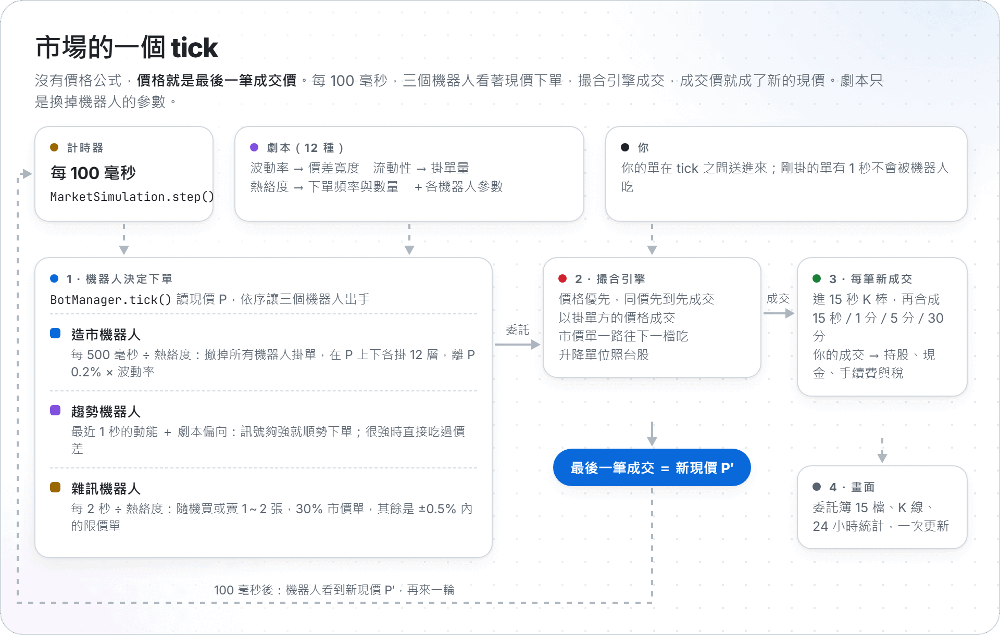
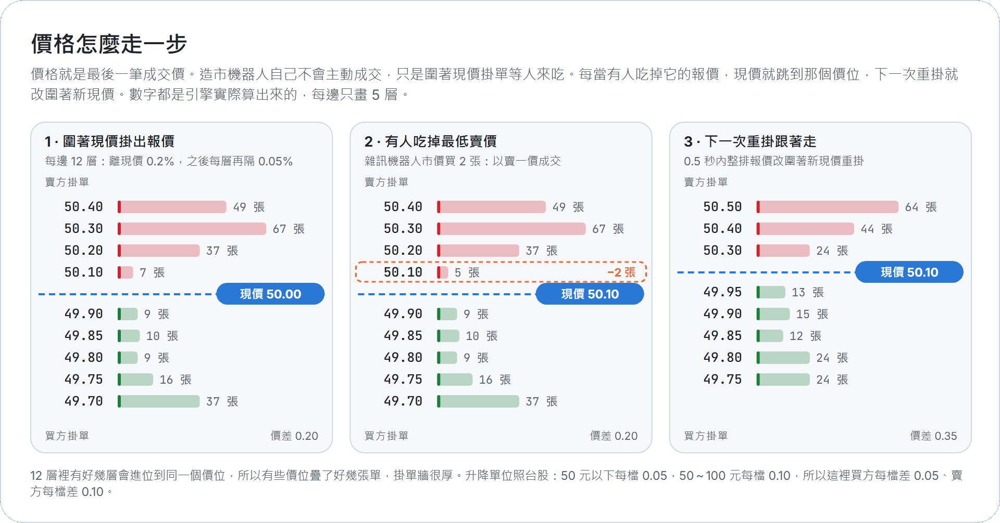
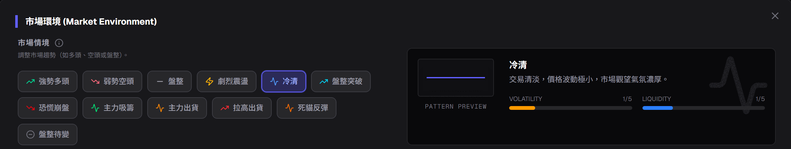
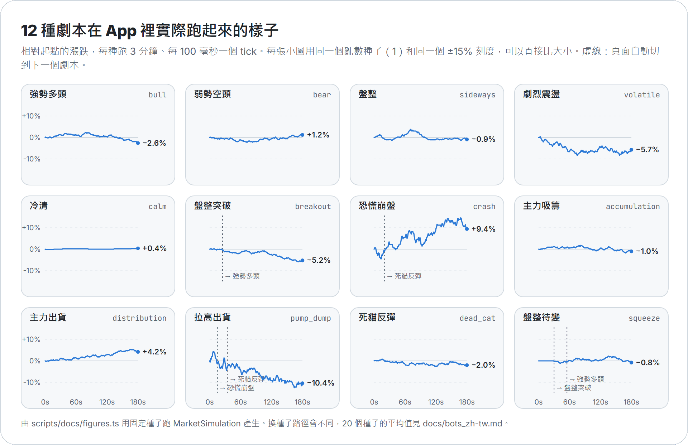
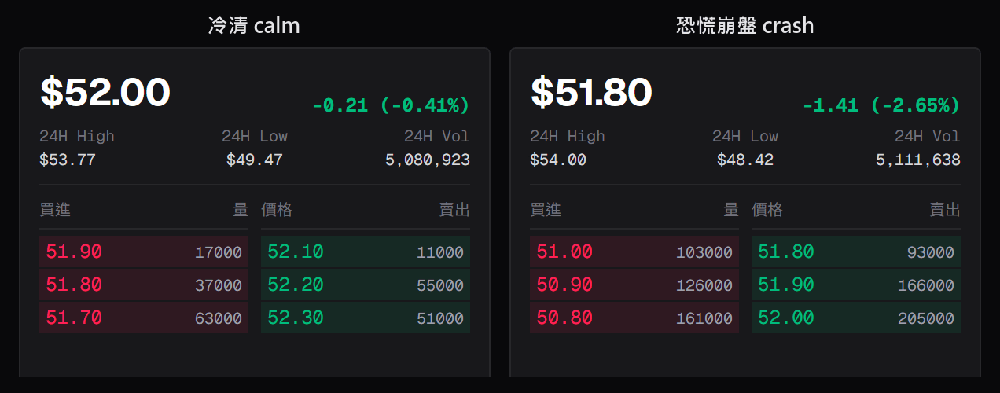
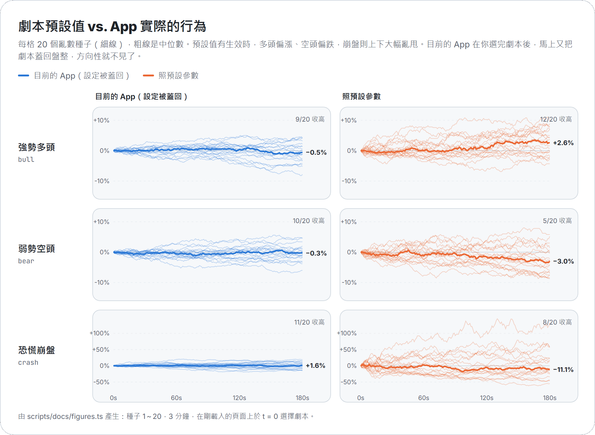

[English](bots.md)

# 機器人怎麼讓價格動起來

Stonk! 裡沒有價格公式。畫面上的價格就是**最後一筆成交價**。三個機器人每 100 毫秒下一次單，撮合引擎把能成交的單成交，最後一筆成交價就成了新的現價。劇本也不是寫好的 K 線劇情，它只是換掉機器人的參數。

這一頁用程式裡的真實數字說明：

- [一個 tick](#一個-tick)：每 100 毫秒發生什麼事
- [撮合引擎](#撮合引擎)：買單和賣單怎麼配對
- [三個機器人](#三個機器人)：各自怎麼下單，附公式
- [價格為什麼會動](#價格為什麼會動)
- [12 種劇本](#12-種劇本)：每個劇本改了什麼，實際跑起來長怎樣
- [已知的怪地方](#已知的怪地方)：App 實際行為跟劇本設定不一樣的地方
- [自己跑跑看](#自己跑跑看)

這頁所有圖表都是用 App 同一套引擎、固定亂數種子跑出來的（`scripts/docs/figures.ts`），可以一模一樣地重現。

## 一個 tick

<picture>
  <source media="(prefers-color-scheme: dark)" srcset="images/tick-loop-zh-dark.png">
  
</picture>

每 100 毫秒，頁面呼叫一次 `MarketSimulation.step()`（`src/lib/sim/MarketSimulation.ts`）：

1. **機器人決定下單。** `BotManager.tick()` 先讀一次現價 P，接著：
   - 每 5 秒撤掉離 P 超過 10% 的機器人掛單；
   - 看最佳買價或賣價是不是使用者 1 秒內剛掛的單（是的話機器人先不跟它成交，見[你的單](#你的單)）；
   - 把 P 記進趨勢機器人的記憶；
   - 時間到了就讓造市機器人重新掛單，再輪到趨勢機器人和雜訊機器人。
2. **撮合。** 機器人的每張單都直接送進 `MatchingEngine.submitOrder()`，當下就跟委託簿撮合。最後一筆成交決定新現價。
3. **成交。** `step()` 用一個成交游標，拿到上一個 tick 之後的每一筆成交（機器人的和你的），放進 15 秒 K 棒；頁面再把你自己的成交記進持股和現金。
4. **畫面。** 委託簿（15 檔）、K 線、24 小時統計，整理成一份快照交給 React 更新。

第一個 tick 之前，圖表會先填入一段假的歷史：從當天 09:00 到現在，用隨機漫步產生 15 秒 K 棒（每根漲跌 `trend + (U − 0.5) × vol`，`vol` 介於 0.2%～0.5%，`trend` 是很小的隨機值；`U` 是 [0, 1) 之間的均勻亂數）。引擎從這段歷史的最後收盤價開始交易。

## 撮合引擎

`src/lib/matching/MatchingEngine.ts` 是一個小而老實的限價委託簿：

- **價格優先、時間優先。** 價格最好的先成交；同價位的話，先掛的先成交。
- **以掛單方（maker）的價格成交。** 買方限價 50.30 遇到 50.10 的賣單，就以 50.10 成交。
- **市價單一檔一檔往下吃**，直到成交完。GTC 沒成交的部分會變成以最後成交價掛出的限價單；IOC 剩下的直接刪掉；FOK 要嘛全部成交，要嘛整張取消。（下單表單的市價單預設是 IOC。）
- **價位照台股升降單位：** 10 元以下 0.01、50 元以下 0.05、100 元以下 0.1、500 元以下 0.5、1000 元以下 1、以上 5。價格最低 0.01。

## 三個機器人

符號：P 是現價，U 是每次重新抽的 [0, 1) 均勻亂數，I 是熱絡度（「市場熱絡度」滑桿，選劇本時會跟著設定）。機器人用「張」思考，最後由 `BotManager` 換算成股數（見[下單數量](#下單數量)）。

### 造市機器人（`MarketMakerBot`）

造市機器人就是委託簿本身。它不會主動成交，只是掛著等人來吃。

每 `500 毫秒 ÷ I`，它會**撤掉所有機器人掛單**（自己的和另外兩個機器人的），再在每一邊掛上 `L = depth + floor(2 × I)` 層新報價（預設 depth 10，I = 1 時是 12 層）：

```
s      = spreadPercent × volatility             （預設 spreadPercent 0.2%）
bid_i  = floorToTick( P × (1 − s − 0.0005 × i) )      i = 0 … L−1
ask_i  = ceilToTick(  P × (1 + s + 0.0005 × i) )
size_i = floor( (2 + U × 8) × liquidity × (1 + 2i / L) )   張
```

所以最近的報價離現價 `s`，之後每層再遠 0.05%，越外層量越大（最多約 3 倍）。在 50 元附近，12 層裡有好幾層會進位到同一個價位，所以一個價位常疊好幾張單，30～70 張的掛單牆很常見。

`MarketMakerBot` 也寫了「庫存偏移」（持有太多時調整報價），但從來沒有人把成交通知它，庫存一直是 0，報價永遠對稱（[怪地方 4](#已知的怪地方)）。

### 趨勢機器人（`TrendBot`）

趨勢機器人追動能，再加上劇本給的偏向。

它每個 tick 都記下 P。輪到它時計算：

```
T = clamp( 100 × (最近 5 個價格平均 − 再往前 5 個的平均) / 再往前 5 個的平均, −1, 1 )
B = 劇本偏向：強勢多頭 +0.3、弱勢空頭 −0.3、劇烈震盪隨機 ±0.2，其餘 0
C = T + B                                   （大於 0 表示買）
強度 = C > 0 時用 buyStrength，否則用 sellStrength       （沒設定就用 aggressiveness）
```

5 個價格就是 5 個 tick，所以 T 是在比較「最近 0.5 秒」和「再前 0.5 秒」；半秒內漲跌 1% 就已經頂到最大值。接著：

- **訊號太弱：** `|C| < 0.3 × (1 − 強度)` 時什麼都不做，下一個 tick 再看。
- **數量：** `floor(2 + 3 × |C| × 強度)` 張，也就是 2～5 張。
- **訊號很強（|C| > 0.6）：** 用 `P × 1.005`（買）或 `P × 0.995`（賣）掛限價單。這個價格會越過價差，像有價格上限的市價單一樣往下吃。90% 的機率真的送出。
- **一般訊號：** 在自己那一邊離現價 0.1%～0.3% 掛被動單（買單掛在 P 下面，賣單掛在 P 上面）。70% 的機率送出；如果沒人來吃，造市機器人下一次重掛時（半秒內）就會把它撤掉。

出手一次之後（不管有沒有被亂數跳過），它會等 `tradeInterval ÷ I`（預設 3 秒）。

### 雜訊機器人（`NoiseBot`）

雜訊機器人代表散戶。每 `tradeInterval ÷ I`（預設 2 秒）下一張單：

```
方向 = 買或賣，各一半
數量 = floor(1 + U × 2) 張            （1 或 2 張；設定上限 3 張永遠不會出現）
種類 = 有 marketOrderProbability（預設 30%）的機率是市價單，否則是限價單
限價 = roundToTick( P × (1 + (U − 0.5) × 1%) )       （P 上下 ±0.5% 內）
```

市價單直接吃最佳買價或賣價。限價單如果剛好越過價差就立刻成交，其他的就掛著，直到下一次重掛被清掉。

### 下單數量

`BotManager.processOrders()` 把機器人的張數換成股數：

```
整股：股數 = max(1000, round(張數 × unitSize × √I / 1000) × 1000)     unitSize = 1000 × 「每筆規模」
零股：股數 = floor(張數 × 100 × √I) + 隨機 0～98 股
```

連發：如果某個機器人的間隔除以 I 小於 100 毫秒，`BotManager` 會讓它在同一個 tick 跑好幾次。但滑桿最高只到 5.0，所以實際上不會發生（最快是 500 毫秒 ÷ 5 = 100 毫秒）。

### 你的單

你的單在兩個 tick 之間送進同一本委託簿，照同樣的規則成交。如果你的單排在最佳買價或賣價的第一位，而且掛上去還不到 1 秒（`reactionDelay`），機器人會先跳過會跟它成交的市價單和限價單，模擬「需要一點時間反應」。

## 價格為什麼會動

<picture>
  <source media="(prefers-color-scheme: dark)" srcset="images/ladder-zh-dark.png">
  
</picture>

造市機器人永遠離現價一個價差，所以只有在有人**吃掉**它的報價時，價格才會變：

1. 雜訊機器人用市價買進，在最佳賣價成交，現價就往上跳約一個價差。
2. 半秒內，造市機器人改圍著新現價重掛。
3. 下一個吃單的人再把價格往上或往下推。

所以價格是一個由「吃單的人」推動的隨機漫步，每一步大約是 `spreadPercent × volatility` 再加上進位到價位的誤差。每個參數各司其職：

- **波動率**把價差拉寬，每一步就變大。
- **熱絡度**讓每個人更常出手（每分鐘走更多步），單也稍微變大（×√I）。
- **趨勢機器人**加入動能：連漲幾步後它會跟進，|C| 超過 0.6 時自己吃過價差。劇本偏向和買賣強度決定它比較容易跟哪一邊。
- **流動性**只改變每個價位疊了多少張。機器人的單只有 1～5 張，對上幾十張的掛單牆，所以它影響的是成交量，不是走勢。
- **升降單位**讓價差有個下限。在 50 元附近一檔就是價格的 0.1%～0.2%，所以價差設得很小的劇本（冷清、盤整、主力吸籌、主力出貨、盤整待變）最後都會進位成一樣的一兩檔。這也是為什麼下面 20 個種子的表格裡，主力吸籌和主力出貨兩欄的數字完全一樣：兩欄只差在流動性，以及一個進位後相同的價差。

## 12 種劇本



每個劇本是 `SCENARIO_MODIFIERS`（`src/lib/bots/types.ts`）裡的一筆設定。選劇本時，熱絡度滑桿也會跳到該劇本的熱絡度。有 4 個劇本會自己接到下一個（`SCENARIO_LIFECYCLE`）：拉高出貨 15 秒後轉恐慌崩盤、再 20 秒後轉死貓反彈；盤整待變 30 秒後轉盤整突破、再 25 秒後轉強勢多頭。

在剛載入的頁面上選擇時，各劇本的設定（衍生的數值是用上面的公式算的）：

| 劇本 | 波動率 | 流動性 | 熱絡度 | 造市價差 | 每邊層數 | 重掛間隔 | 趨勢 買／賣強度 | 趨勢間隔 | 雜訊間隔 | 雜訊市價單 | 趨勢偏向 | 接著 |
|---|---:|---:|---:|---:|---:|---:|---|---:|---:|---:|---:|---|
| 強勢多頭 `bull` | 1.2 | 1.5 | 1.5 | 0.24% | 13 | 333 ms | 0.8 / 0.2 | 2000 ms | 667 ms | 50% | +0.3 |  |
| 弱勢空頭 `bear` | 1.3 | 1.2 | 1.5 | 0.26% | 13 | 333 ms | 0.2 / 0.8 | 2000 ms | 667 ms | 50% | −0.3 |  |
| 盤整 `sideways` | 0.6 | 2 | 0.8 | 0.12% | 11 | 625 ms | 0.5 / 0.5 | 3750 ms | 1250 ms | 50% | 0 |  |
| 劇烈震盪 `volatile` | 2.5 | 0.8 | 2.5 | 1.25% | 15 | 200 ms | 0.6 / 0.6 | 400 ms | 400 ms | 50% | 隨機 ±0.2 |  |
| 冷清 `calm` | 0.3 | 3 | 0.3 | 0.06% | 10 | 1667 ms | 關閉 | – | 16667 ms | 30% | 0 |  |
| 盤整突破 `breakout` | 1.8 | 1.3 | 2 | 0.36% | 14 | 250 ms | 0.9 / 0.1 | 750 ms | 1000 ms | 50% | 0 | 25 秒後 `bull` |
| 恐慌崩盤 `crash` | 3 | 0.5 | 3 | 3.00% | 11 | 167 ms | 0.05 / 0.95 | 267 ms | 333 ms | 70% | 0 | 20 秒後 `dead_cat` |
| 主力吸籌 `accumulation` | 0.6 | 1.8 | 1.2 | 0.12% | 17 | 417 ms | 0.75 / 0.25 | 1667 ms | 833 ms | 50% | 0 |  |
| 主力出貨 `distribution` | 0.8 | 1.5 | 1.3 | 0.16% | 14 | 385 ms | 0.3 / 0.7 | 1538 ms | 769 ms | 50% | 0 |  |
| 拉高出貨 `pump_dump` | 2.5 | 1.2 | 4 | 2.50% | 18 | 125 ms | 0.9 / 0.1 | 125 ms | 250 ms | 50% | 0 | 15 秒後 `crash` |
| 死貓反彈 `dead_cat` | 2 | 0.8 | 2 | 0.40% | 14 | 250 ms | 0.6 / 0.4 | 750 ms | 500 ms | 50% | 0 |  |
| 盤整待變 `squeeze` | 0.1 | 0.5 | 0.5 | 0.02% | 11 | 1000 ms | 0.5 / 0.5 | 10000 ms | 16000 ms | 30% | 0 | 30 秒後 `breakout` |

怎麼看這張表：

- 只有強勢多頭、弱勢空頭、劇烈震盪有**偏向**。其他看起來有方向的劇本（盤整突破、恐慌崩盤、主力吸籌、主力出貨、拉高出貨、死貓反彈）只靠買賣強度不對稱：強度 0.9 時，趨勢機器人在 +0.03 的訊號就會買；強度 0.1 時，要到 −0.27 才會賣。這讓它比較快跟上某一邊的行情，但它自己不會製造行情。
- 大多數劇本的**雜訊**欄位其實是盤整的值，因為那些劇本沒有設定雜訊機器人，就沿用原本的設定（[怪地方 2](#已知的怪地方)）。
- 在目前的 App 裡，除了盤整以外，每個劇本的造市價差都是 `spreadPercent × 0.6`（[怪地方 1](#已知的怪地方)）：大多是 0.12%，劇烈震盪 0.30%，恐慌崩盤和拉高出貨 0.60%。

### 劇本在目前的 App 裡實際跑起來

<picture>
  <source media="(prefers-color-scheme: dark)" srcset="images/scenarios-zh-dark.png">
  
</picture>

同一個種子、同一個刻度，每種 3 分鐘，就是交易頁面現在的跑法。冷清幾乎不動，劇烈震盪、恐慌崩盤、拉高出貨明顯擺得比較大。但強勢多頭和弱勢空頭並沒有往自己的方向走：這次強勢多頭收在 −2.6%。

真實的委託簿也看得出差別。下面是在執行中的 App 裡，選冷清和恐慌崩盤幾秒後的報價卡：



20 個種子、每次 3 分鐘的平均（`app` 是目前的 App，`preset` 是照劇本設定，下一節說明差在哪）：

| 劇本 | 模式 | 平均漲跌 | 收高次數 | 平均高低差 | 典型 1 秒波動 | 平均價差 | 每分鐘成交筆數 |
|---|---|---:|---:|---:|---:|---:|---:|
| 強勢多頭 `bull` | app | −0.6% | 9/20 | 4.3% | 0.20% | 0.39% | 59 |
|  | preset | +2.7% | 12/20 | 7.6% | 0.34% | 0.65% | 56 |
| 弱勢空頭 `bear` | app | −0.3% | 10/20 | 3.8% | 0.20% | 0.39% | 59 |
|  | preset | −2.8% | 5/20 | 7.4% | 0.33% | 0.63% | 56 |
| 盤整 `sideways` | app | +0.3% | 8/20 | 3.8% | 0.19% | 0.51% | 30 |
|  | preset | +0.5% | 8/20 | 3.0% | 0.14% | 0.39% | 32 |
| 劇烈震盪 `volatile` | app | +0.1% | 10/20 | 7.5% | 0.43% | 0.63% | 92 |
|  | preset | +2.8% | 10/20 | 35.1% | 1.47% | 1.91% | 99 |
| 冷清 `calm` | app | +0.1% | 9/20 | 0.6% | 0.04% | 0.40% | 2 |
|  | preset | +0.1% | 9/20 | 0.4% | 0.03% | 0.29% | 2 |
| 盤整突破 `breakout` | app | −0.7% | 7/20 | 4.0% | 0.19% | 0.39% | 57 |
|  | preset | +0.3% | 8/20 | 4.7% | 0.25% | 0.69% | 29 |
| 恐慌崩盤 `crash` | app | +1.2% | 11/20 | 15.1% | 0.75% | 1.29% | 70 |
|  | preset | +4.2% | 8/20 | 59.6% | 2.74% | 3.80% | 103 |
| 主力吸籌 `accumulation` | app | −0.5% | 9/20 | 3.4% | 0.18% | 0.38% | 46 |
|  | preset | −0.5% | 9/20 | 3.4% | 0.18% | 0.38% | 46 |
| 主力出貨 `distribution` | app | −0.6% | 9/20 | 3.8% | 0.18% | 0.38% | 51 |
|  | preset | −0.6% | 9/20 | 3.8% | 0.18% | 0.38% | 51 |
| 拉高出貨 `pump_dump` | app | +3.1% | 10/20 | 19.5% | 0.75% | 1.11% | 73 |
|  | preset | −8.3% | 5/20 | 60.4% | 2.82% | 3.58% | 102 |
| 死貓反彈 `dead_cat` | app | −0.7% | 8/20 | 4.5% | 0.23% | 0.40% | 82 |
|  | preset | −1.4% | 9/20 | 10.5% | 0.50% | 0.93% | 69 |
| 盤整待變 `squeeze` | app | +0.1% | 7/20 | 3.8% | 0.18% | 0.39% | 47 |
|  | preset | +0.1% | 8/20 | 4.6% | 0.23% | 0.59% | 25 |

「典型 1 秒波動」是每秒價格變化的標準差。價差是相對於買賣中間價的比例。

## 已知的怪地方

以下是程式目前的行為。改掉會影響遊戲手感，所以先寫下來，沒有直接修。

1. **選了劇本，馬上又被蓋回盤整。** 選劇本時會先呼叫 `setScenario`，再移動熱絡度滑桿。滑桿一變，`useMarketSimulator` 就把頁面的設定整包重送一次，裡面包含預設劇本 `sideways`，於是 `BotManager` 又套用一次盤整：波動率回到 0.6、流動性回到 2.0、趨勢偏向歸零。機器人自己的參數（價差、強度、間隔）還是你選的劇本，畫面上也還是顯示你選的劇本。結果是：多頭和空頭失去方向性，劇烈震盪、崩盤、拉高出貨比劇本設定溫和很多。自動切換劇本時也一樣。有兩個例外：選盤整本身（或剛載入頁面）會以波動率 1.0、流動性 1.0 運作；如果滑桿數值沒變（例如先選多頭再選空頭，都是 1.5），就不會重送設定，第二次的選擇會生效（直到你改其他設定）。

   <picture>
     <source media="(prefers-color-scheme: dark)" srcset="images/presets-vs-app-zh-dark.png">
     
   </picture>

   照劇本設定跑的話，多頭和空頭確實會往自己的方向偏，但恐慌崩盤和拉高出貨會變成 ±60% 的擲硬幣，而不是崩盤：3% 的價差加上 70% 的市價單，主要只是放大雜訊。
2. **劇本只覆蓋自己有寫的設定。** `applyScenario` 是把劇本合併進目前的設定，所以劇本沒寫到的部分（大多沒寫造市和雜訊機器人）會沿用上一個劇本的值。先選恐慌崩盤再選強勢多頭，多頭就會帶著崩盤的 1% 造市價差和 5 層深度，而不是 0.2% 和 10 層。
3. **重掛會清掉所有機器人掛單。** 造市機器人重掛時會撤掉所有機器人的單，所以趨勢和雜訊機器人的被動掛單最多只活 `500 毫秒 ÷ I`。
4. **庫存偏移從來沒有收到資料。** 沒有任何地方呼叫 `BotManager.onTrade`，所以造市機器人的庫存一直是 0。照目前的寫法，就算接上也會往反方向推：多頭部位太多時，它反而把賣單掛得更遠，更不容易賣出。
5. **其他小地方。** 雜訊機器人永遠不會下到最大張數（`1 + U × 2` 取 `floor`），造市機器人的基本張數也因為同樣原因到不了上限 10 張；連發模式在滑桿範圍內不會觸發；劇本說明卡上的波動率／流動性長條是手寫的說明（冷清顯示流動性 1/5，但它的設定是所有劇本裡最高的 3.0）。

## 自己跑跑看

```bash
npm run sim -- --scenario crash --seed 7            # 目前 App 的行為
npm run sim -- --scenario bull --mode preset         # 照劇本設定
npm run sim -- --all --minutes 1                     # 每種劇本都跑
npm run sim -- --scenario pump_dump --no-lifecycle   # 一直停在拉高出貨
```

```text
pump_dump (app, seed 2, 180 s)  0s pump_dump -> 15s crash -> 35s dead_cat
  50.00 ▁▁▂▃▃▂▄▄▅▆▆▅▅▆▆▆▆▅▆▆▆▆▆▇▆▆▆▅▆▆▆▆▆▆▆▆▆▅▅▆▆▇▇▇▇█▇▇▇▇▆▆▆▇▆▆▅▅▅▅▅ 55.90
  change +11.80%  high +20.20%  low +0.00%  1 s move 0.81%  spread 1.13%  74 trades/min
```

要重新產生這一頁的圖：先跑 `npx tsx scripts/docs/figures.ts`（加 `--table` 會印出上面的表格），再跑 `node scripts/docs/render.mjs`（需要 Edge 或 Chrome，以及 ImageMagick）。

在自己的程式裡，`MarketSimulation` 可以傳入一個 `SimEnv`，裡面放固定種子的亂數和手動控制的時鐘：

```ts
import { MarketSimulation, deterministicEnv } from '@/lib/sim';

const env = deterministicEnv(42);
const sim = new MarketSimulation({ initialPrice: 50, candlePeriod: 15000 }, env);
sim.bots.setScenario('volatile');
for (let i = 0; i < 600; i++) {   // 一分鐘
    env.clock.advance(100);
    sim.step();
}
console.log(sim.engine.getLastPrice());
```
